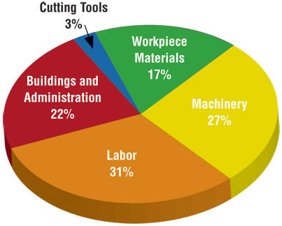
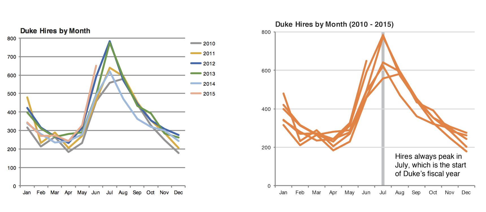
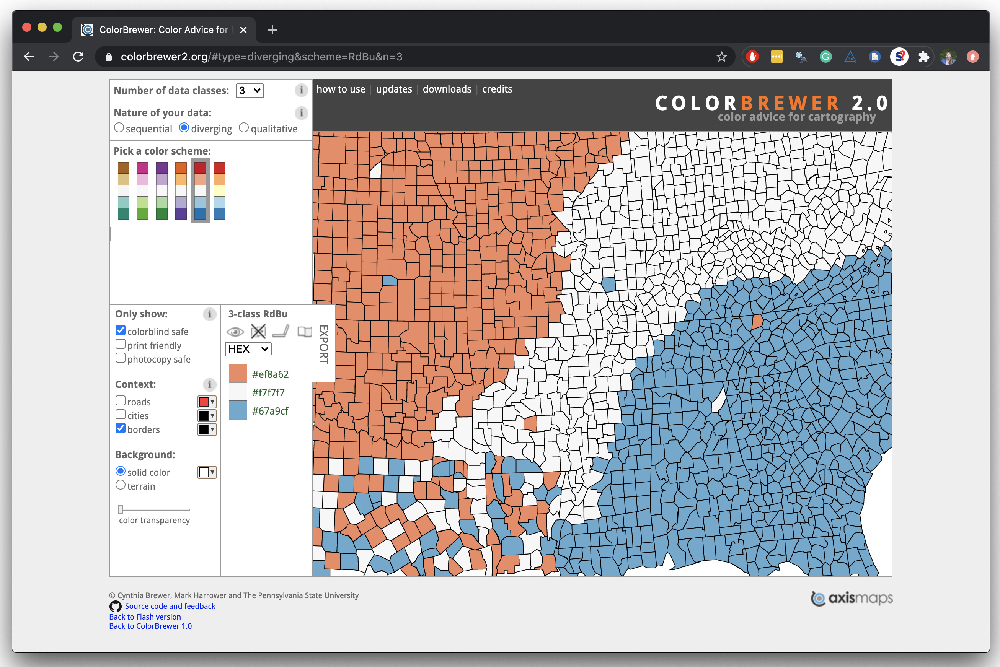

# Effective Data Visualization {background-color="#92A86A"}

## Q&A {.scrollable .smaller}

::: {.callout-note collapse="true" title="Q: Why was there a problem with the police not knowing whether the participants ingested a placebo, lower percentage, or higher percentage of THC?"}
A: I was not as clear as I should have been in this! The police knew that some participants received a placebo and some did not (that's fine!), but they *also* knew how long it had been since they had smoked the joint. So, they would have expected (given knowing this information) that at each subsequent field sobriety test that they should maybe expect fewer and fewer participants to be impaired. Given unlimited resources, a more ideal design would have been to bring officers in randomly, without them knowing how far along the study was, so they didn't have any expectation/knowledge about how recently someone could have smoked (which is the case at the roadside...they don't know)
:::

::: {.callout-note collapse="true" title="Q: confused about the cutoffs - what do they mean"}
A: The cutoffs are *if* we used that cutoff to determine someone had recently used then how many people would be "over the limit."
:::

::: {.callout-note collapse="true" title="Q: could you make a list or link where i can read or see more about different ggplot resources?"}
A: Some people find tidyverse cheat sheets particulrly helpful: https://opensource.posit.co/resources/cheatsheets/data-visualization/. Chapter 9 of our textbook also goes through the basics: https://r4ds.hadley.nz/layers.html. There are a lot of additional resources - if others have found some they really like, please share!
:::

## Course Announcements {.scrollable .smaller}

**Due Dates**:

-   ⌨️ **Lab 03** due tonight 10/16 (11:59 PM)
-   📚 **HW 02** due *next* Sun 10/25 (11:59 PM) \<- this is an update
-   🔘 Lecture Participation survey "due" after class

Notes:

-   Data in these notes are in lab03
-   Lab 02 scores/feedback were posted - everyone got some comment/feedback in their issue on GH
-   pre-course survey EC posted
    -   will get an email response later
    -   lots of cool things you're good at:
        -   Dance
        -   Guitar
        -   Running
        -   Big-picture thinking
        -   Art
        -   Hyping people up
        -   Baking
        -   Badminton
        -   Serving/waitressing
        -   Fast typing (\~100 WPM)
        -   A cappella
        -   Rowing
        -   Painting Warhammer miniatures
        -   Video editing
        -   Swimming
        -   Gel-X nails
        -   Sewing
        -   Community organizing
        -   Photography and live events
        -   Soccer
        -   Architecture and floorplan drawing
        -   Writing poetry
        -   Sleeping
        -   Basketball
        -   Trip planning
        -   Braising pork

## Suggested Reading

-   R4DS Chapter 11: [Data Communication](https://r4ds.hadley.nz/communication)
-   The Glamour of Graphics: \[[video](https://posit.co/resources/videos/the-glamour-of-graphics)\] \[[Prof's slides inspired by Will's talk](https://docs.google.com/presentation/d/1wT9M4J2O72s_pbcoqmaNLgBQJIUi2SzmvSmULmOWbSM/edit?usp=sharing)\]

```{r packages, echo = FALSE, message=FALSE, warning=FALSE}
library(tidyverse)

knitr::opts_chunk$set(fig.height = 3.5, dpi = 300, echo=TRUE) 
```

## Keep it simple

::: columns
::: {.column width="50%"}
```{r pie-3d, echo = FALSE, out.width="100%", fig.alt="A 3D pie chart of five cost categories; the tilted perspective makes the slices hard to compare."}

```
:::

::: {.column width="50%"}
```{r pie-to-bar, echo = FALSE, out.width="100%", fig.alt="The same five cost categories as a horizontal bar chart sorted by size: Labor is largest, then Machinery, Buildings and administration, Workpiece materials, and Cutting tools."}
d <- tribble(
  ~category, ~value,
  "Cutting tools", 0.03,
  "Buildings and administration", 0.22,
  "Labor", 0.31,
  "Machinery", 0.27,
  "Workpiece materials", 0.17
)
ggplot(d, aes(x = value, y = fct_reorder(category, value))) +
  geom_col() +
  scale_x_continuous(labels = scales::label_percent()) +
  theme_minimal() +
  labs(x = NULL, y = NULL)
```
:::
:::

## Use color to draw attention

::: columns
::: {.column width="50%"}
```{r echo = FALSE, out.width="100%"}
d |>
  mutate(category = str_replace(category, " ", "\n")) |>
  ggplot(aes(x = category, y = value, fill = category)) +
  geom_col() +
  theme_minimal() +
  labs(x = "", y = "") +
  theme(legend.position = "none")
```
:::

::: {.column width="50%"}
```{r echo = FALSE, out.width="100%"}
# highlight the largest category (Labor) by name, not by position
ggplot(d, aes(x = value, y = fct_reorder(category, value),
              fill = category == "Labor")) +
  geom_col() +
  scale_x_continuous(labels = scales::label_percent()) +
  scale_fill_manual(values = c("TRUE" = "red", "FALSE" = "gray")) +
  theme_minimal() +
  labs(x = NULL, y = NULL) +
  theme(legend.position = "none")
```
:::
:::

## Tell a story

```{r echo = FALSE, out.width = "100%", fig.alt="Two versions of Duke hires by month, 2010 to 2015. Left: one line per year in six colors with a legend, hard to read. Right: all years in a single color with July highlighted and the note: Hires always peak in July, which is the start of Duke's fiscal year."}

```

::: aside
Credit: Angela Zoss and Eric Monson, Duke DVS
:::

# Principles for effective visualizations {background-color="#92A86A"}

## Principles for effective visualizations

-   Order matters
-   Put long categories on the y-axis
-   Choose an appropriate scale
-   Pick a purpose
-   Keep scales consistent (and say so when you don't)
-   Select meaningful colors
-   Use meaningful and nonredundant labels
-   Tell a story

. . .

Today we'll apply each of these to our CS01 data.

## The data

The cleaned, combined CS01 data (the same `data/cs01_combined.csv` that's in your lab03 repo):

```{r load-cs01, message=FALSE}
cs01 <- read_csv("data/cs01_combined.csv")

# mostly, we'll focus on whole blood
# (2 blood samples have no recorded time, so no time window)
wb <- cs01 |>
  filter(fluid_type == "WB", !is.na(timepoint))
```

# Order matters {background-color="#92A86A"}

## Alphabetical is rarely ideal

How many blood samples were collected in each time window?

::: panel-tabset
### Plot

```{r ref.label="time-default", echo = FALSE}
```

### Code

```{r time-default, fig.show = "hide"}
ggplot(wb, aes(x = timepoint)) +
  geom_bar()
```
:::

. . .

[🧠 What's wrong with this order? Why did it happen?]{style="background-color: #ADD8E6"}

## Why alphabetical?

-   `clean_cs01()` made `timepoint` a factor with levels in time order
-   But a CSV file only stores text, so `read_csv()` reads `timepoint` back in as a character variable
-   `ggplot2` sorts character variables alphabetically: "101-180 min" comes before "31-70 min", and "pre-smoking" ends up last

. . .

You will run into this in CS01. Fix it once, right after reading in the data.

## Use inherent level order

::: panel-tabset
### Relevel

`fct_relevel`: Reorder factor levels using a custom order

```{r time-relevel}
#| code-line-numbers: "5-6"

window_order <- c("pre-smoking", "0-30 min", "31-70 min", "71-100 min",
                  "101-180 min", "181-210 min", "211-240 min",
                  "241-270 min", "271-300 min", "301+ min")

wb <- wb |>
  mutate(timepoint = fct_relevel(timepoint, window_order))
```

### Plot

```{r echo = FALSE}
ggplot(wb, aes(x = timepoint)) +
  geom_bar()
```
:::

## Put long categories on the y-axis

**Overlapping labels are hard to read**

::: panel-tabset
### Plot

```{r ref.label="time-y", echo = FALSE}
```

### Code

```{r time-y, fig.show = "hide"}
#| code-line-numbers: "1"

ggplot(wb, aes(y = timepoint)) +
  geom_bar()
```
:::

## And reverse the order of levels

So time reads from top to bottom:

::: panel-tabset
### Plot

```{r ref.label="time-rev", echo = FALSE}
```

### Code

`fct_rev`: Reverse order of factor levels

```{r time-rev, fig.show = "hide"}
#| code-line-numbers: "1"

ggplot(wb, aes(y = fct_rev(timepoint))) +
  geom_bar()
```
:::

## Clean up labels

::: panel-tabset
### Plot

```{r ref.label="time-labels", echo = FALSE}
```

### Code

```{r time-labels, fig.show = "hide"}
#| code-line-numbers: "3-6"

ggplot(wb, aes(y = fct_rev(timepoint))) +
  geom_bar() +
  labs(
    x = "Number of blood samples",
    y = "Time window (minutes since smoking began)"
  )
```
:::

. . .

[🧠 Why might some windows have more samples than others?]{style="background-color: #ADD8E6"}

# Choose an appropriate scale {background-color="#92A86A"}

## The first 30 minutes

For the rest of today: blood THC in the first window after smoking.

```{r early}
wb_early <- wb |>
  filter(timepoint == "0-30 min")
```

## Order matters (again)

::: panel-tabset
### Plot

```{r ref.label="trt-default", echo = FALSE}
```

### Code

```{r trt-default, fig.show = "hide"}
ggplot(wb_early, aes(x = thc, y = treatment)) +
  geom_boxplot()
```
:::

. . .

Doses are in alphabetical order ("13.4%" before "5.9%" before "Placebo").

## Relevel by dose

::: panel-tabset
### Relevel

```{r trt-relevel}
#| code-line-numbers: "2-3"

wb_early <- wb_early |>
  mutate(treatment = fct_relevel(treatment,
                                 "Placebo", "5.9% THC (low dose)"))
```

### Plot

```{r trt-relevel-plot, echo = FALSE}
ggplot(wb_early, aes(x = thc, y = treatment)) +
  geom_boxplot()
```
:::

## Skewed data hide the details

```{r ref.label="trt-relevel-plot", echo = FALSE}
```

-   About `r round(100 * mean(wb$thc == 0, na.rm = TRUE))`% of blood THC values are 0, and a few are very large
-   On a linear scale, the placebo group (and anything small) gets squashed against zero

## Transform the scale

::: panel-tabset
### Plot

```{r ref.label="trt-log", echo = FALSE}
```

### Code

```{r trt-log, fig.show = "hide"}
#| code-line-numbers: "3-4"

ggplot(wb_early, aes(x = thc, y = treatment)) +
  geom_boxplot() +
  scale_x_continuous(transform = "pseudo_log",
                     breaks = c(0, 1, 10, 100))
```
:::

-   A log scale spreads out small values and pulls in large ones...but `log(0)` is `-Inf`
-   `"pseudo_log"` acts like a log scale for large values and handles zeros
-   The axis still shows the original values. Always say in the axis label that the scale is transformed.

# Pick a purpose {background-color="#92A86A"}

## Compare groups within each dose

::: panel-tabset
### Plot

```{r ref.label="purpose-dodge", echo = FALSE}
```

### Code

```{r purpose-dodge, fig.show = "hide"}
#| code-line-numbers: "1"

ggplot(wb_early, aes(x = thc, y = treatment, fill = group)) +
  geom_boxplot() +
  scale_x_continuous(transform = "pseudo_log", breaks = c(0, 1, 10, 100))
```
:::

## Compare doses within each group

::: panel-tabset
### Plot

```{r ref.label="purpose-facet", echo = FALSE, fig.asp = 0.45, out.width = "90%"}
```

### Code

```{r purpose-facet, fig.show = "hide"}
#| code-line-numbers: "4"

ggplot(wb_early, aes(x = thc, y = treatment)) +
  geom_boxplot() +
  scale_x_continuous(transform = "pseudo_log", breaks = c(0, 1, 10, 100)) +
  facet_wrap(~group)
```
:::

. . .

[🧠 Which plot better answers "Do frequent users have higher blood THC than occasional users?" Which better answers "Does dose matter?"]{style="background-color: #ADD8E6"}

# Keep scales consistent {background-color="#92A86A"}

## Free scales can mislead

::: panel-tabset
### Plot

```{r ref.label="free-group", echo = FALSE, fig.asp = 0.45, out.width = "90%"}
```

### Code

```{r free-group, fig.show = "hide"}
#| code-line-numbers: "3"

ggplot(wb_early, aes(x = thc, y = treatment)) +
  geom_boxplot() +
  facet_wrap(~group, scales = "free_x")
```
:::

-   Each panel gets its own x-axis: the largest occasional-user value (`r round(max(wb_early$thc[wb_early$group == "Occasional user"], na.rm = TRUE))` ng/mL) stretches as far as the largest frequent-user value (`r round(max(wb_early$thc[wb_early$group == "Frequent user"], na.rm = TRUE))` ng/mL)
-   When panels share units and you want to compare them, keep the default (fixed) scales

## ...but sometimes free scales are the right call

Same first window, three matrices (THC-treated participants only):

::: panel-tabset
### Fixed

```{r ref.label="matrix-fixed", echo = FALSE, fig.asp = 0.4, out.width = "90%"}
```

### Free

```{r ref.label="matrix-free", echo = FALSE, fig.asp = 0.4, out.width = "90%"}
```

### Code

```{r matrix-fixed, fig.show = "hide"}
cs01_early <- cs01 |>
  filter(timepoint %in% c("0-30 min", "0-40 min"),
         treatment != "Placebo")

ggplot(cs01_early, aes(x = thc)) +
  geom_histogram(bins = 30) +
  facet_wrap(~fluid_type)
```

```{r matrix-free, fig.show = "hide"}
#| code-line-numbers: "3-7"

ggplot(cs01_early, aes(x = thc)) +
  geom_histogram(bins = 30) +
  facet_wrap(~fluid_type, scales = "free_x",
             labeller = as_labeller(c(WB = "Blood (ng/mL)",
                                      OF = "Oral fluid (ng/mL)",
                                      BR = "Breath (pg/pad)"))) +
  scale_x_continuous(labels = scales::label_comma())
```
:::

-   Breath values reach the hundreds of thousands, so blood and oral fluid disappear on a shared axis
-   And breath is measured in different units, so comparing raw values across panels isn't meaningful anyway
-   If you free the scales, make it obvious (here: units in every panel label)

# Select meaningful colors {background-color="#92A86A"}

## Default colors don't know your data

::: panel-tabset
### Plot

```{r ref.label="col-default", echo = FALSE}
```

### Code

```{r col-default, fig.show = "hide"}
#| code-line-numbers: "1"

ggplot(wb_early, aes(x = thc, y = treatment, fill = treatment)) +
  geom_boxplot() +
  scale_x_continuous(transform = "pseudo_log", breaks = c(0, 1, 10, 100))
```
:::

-   Dose is *ordered* (none, low, high), but these colors suggest three unrelated categories
-   And red next to green: red-green is the most common form of color vision deficiency (roughly 1 in 12 men)

## Choosing better colors

[colorbrewer2.org](https://colorbrewer2.org/)

```{r echo = FALSE, out.width = "60%", fig.alt="Screenshot of the ColorBrewer website, which suggests sequential, diverging, and qualitative color palettes, including colorblind-safe options."}

```

-   **Sequential**: ordered values (dose, time)
-   **Diverging**: values with a meaningful middle
-   **Qualitative**: unordered categories (user group)

## Use a sequential palette for ordered categories

::: panel-tabset
### Plot

```{r ref.label="col-seq", echo = FALSE}
```

### Code

```{r col-seq, fig.show = "hide"}
#| code-line-numbers: "4-6"

ggplot(wb_early, aes(x = thc, y = treatment, fill = treatment)) +
  geom_boxplot() +
  scale_x_continuous(transform = "pseudo_log", breaks = c(0, 1, 10, 100)) +
  scale_fill_manual(values = c("Placebo" = "#deebf7",
                               "5.9% THC (low dose)" = "#9ecae1",
                               "13.4% THC (high dose)" = "#3182bd"))
```
:::

# Use meaningful and nonredundant labels {background-color="#92A86A"}

## Be selective with redundancy

The legend repeats the y-axis labels:

::: panel-tabset
### Plot

```{r ref.label="no-legend", echo = FALSE}
```

### Code

```{r no-legend, fig.show = "hide"}
#| code-line-numbers: "7"

ggplot(wb_early, aes(x = thc, y = treatment, fill = treatment)) +
  geom_boxplot() +
  scale_x_continuous(transform = "pseudo_log", breaks = c(0, 1, 10, 100)) +
  scale_fill_manual(values = c("Placebo" = "#deebf7",
                               "5.9% THC (low dose)" = "#9ecae1",
                               "13.4% THC (high dose)" = "#3182bd")) +
  guides(fill = "none")
```
:::

## Use informative labels

::: panel-tabset
### Plot

```{r ref.label="labels-final", echo = FALSE}
```

### Code

```{r labels-final, fig.show = "hide"}
#| code-line-numbers: "8-14"

ggplot(wb_early, aes(x = thc, y = treatment, fill = treatment)) +
  geom_boxplot() +
  scale_x_continuous(transform = "pseudo_log", breaks = c(0, 1, 10, 100)) +
  scale_fill_manual(values = c("Placebo" = "#deebf7",
                               "5.9% THC (low dose)" = "#9ecae1",
                               "13.4% THC (high dose)" = "#3182bd")) +
  guides(fill = "none") +
  labs(
    title = "Blood THC in the first 30 minutes after smoking",
    subtitle = "Whole blood samples, 0-30 minutes after smoking began",
    x = "THC (ng/mL, pseudo-log scale)",
    y = NULL,
    caption = "Data: CS01 (Hubbard et al., 2021)"
  )
```
:::

## Select theme

::: panel-tabset
### Plot

```{r ref.label="theme-final", echo = FALSE}
```

### Code

```{r theme-final, fig.show = "hide"}
#| code-line-numbers: "15-17"

ggplot(wb_early, aes(x = thc, y = treatment, fill = treatment)) +
  geom_boxplot() +
  scale_x_continuous(transform = "pseudo_log", breaks = c(0, 1, 10, 100)) +
  scale_fill_manual(values = c("Placebo" = "#deebf7",
                               "5.9% THC (low dose)" = "#9ecae1",
                               "13.4% THC (high dose)" = "#3182bd")) +
  guides(fill = "none") +
  labs(
    title = "Blood THC in the first 30 minutes after smoking",
    subtitle = "Whole blood samples, 0-30 minutes after smoking began",
    x = "THC (ng/mL, pseudo-log scale)",
    y = NULL,
    caption = "Data: CS01 (Hubbard et al., 2021)"
  ) +
  theme_minimal(base_size = 16) +
  theme(plot.title.position = "plot",
        panel.grid.major.y = element_blank())
```
:::

::: aside
Built-in themes described [here](https://ggplot2.tidyverse.org/reference/ggtheme.html); the [`ggthemes`](https://jrnold.github.io/ggthemes/) package has more
:::

# Tell a story {background-color="#92A86A"}

## What's the takeaway?

```{r ref.label="theme-final", echo = FALSE}
```

[🧠 What do you notice about the low vs. high dose? What might explain it? (Think back to the smoking topography slides from the CS01 intro.)]{style="background-color: #ADD8E6"}

## Put the message in the title

::: panel-tabset
### Plot

```{r ref.label="story", echo = FALSE}
```

### Code

```{r story, fig.show = "hide"}
#| code-line-numbers: "3,10"

ggplot(wb_early, aes(x = thc, y = treatment, fill = treatment)) +
  geom_boxplot(outlier.shape = NA) +
  geom_jitter(height = 0.15, alpha = 0.4, size = 1) +
  scale_x_continuous(transform = "pseudo_log", breaks = c(0, 1, 10, 100)) +
  scale_fill_manual(values = c("Placebo" = "#deebf7",
                               "5.9% THC (low dose)" = "#9ecae1",
                               "13.4% THC (high dose)" = "#3182bd")) +
  guides(fill = "none") +
  labs(
    title = "Blood THC was no higher after the high dose",
    subtitle = "Whole blood samples, 0-30 minutes after smoking began",
    x = "THC (ng/mL, pseudo-log scale)",
    y = NULL,
    caption = "Data: CS01 (Hubbard et al., 2021)"
  ) +
  theme_minimal(base_size = 16) +
  theme(plot.title.position = "plot",
        panel.grid.major.y = element_blank())
```
:::

-   A title can describe the plot ("Blood THC in the first 30 minutes") or state its message
-   Adding the points shows how many people are behind each box (and how much they vary)

## Principles recap {.smaller}

What we covered (cite these by name in your homework and case studies):

-   **Keep it simple**: skip 3D and pies when a bar chart does the job
-   **Use color to draw attention** to what matters
-   **Tell a story**: put the takeaway in the title or an annotation
-   **Order matters**: avoid alphabetical; use inherent order or order by frequency
-   **Put long categories on the y-axis**
-   **Choose an appropriate scale**: transform skewed data (and say so)
-   **Pick a purpose**: decide which comparison the plot should make easy (e.g., dodged vs. faceted)
-   **Keep scales consistent** across panels, unless units differ (and then say so)
-   **Select meaningful colors**: sequential for ordered values, colorblind-friendly, consistent meaning
-   **Use meaningful and nonredundant labels**: titles, units, sources; drop redundant legends

## Your Turn {.smaller}

New data! In September 2019, a YouGov survey asked 1,639 GB adults: *In hindsight, do you think Britain was right/wrong to vote to leave EU?* (Right to leave / Wrong to leave / Don't know)

```{r brexit-data}
brexit <- tibble(
  opinion = c(
    rep("Right", 664), rep("Wrong", 787), rep("Don't know", 188)
  ),
  region = c(
    rep("london", 63), rep("rest_of_south", 241), rep("midlands_wales", 145), rep("north", 176), rep("scot", 39),
    rep("london", 110), rep("rest_of_south", 257), rep("midlands_wales", 152), rep("north", 176), rep("scot", 92),
    rep("london", 24), rep("rest_of_south", 49), rep("midlands_wales", 57), rep("north", 48), rep("scot", 10)
  )
)
```

-   Make a bar chart of opinion by region
-   Then improve it using at least three of today's principles (name them!)
-   Think of two different purposes (stories) these data could serve

::: aside
Source: [YouGov Survey Results](https://d25d2506sfb94s.cloudfront.net/cumulus_uploads/document/x0msmggx08/YouGov%20-%20Brexit%20and%202019%20election.pdf), 2-3 September 2019
:::

::: aside
Put a [green]{.sticky-green} sticky on the front of your computer when you're done. Put a [pink]{.sticky-pink} if you want help/have a question.
:::

# Recap {background-color="#92A86A"}

-   Can you determine what needs to be done to improve the effectiveness of your visualizations?
-   Can you choose scales, colors, and labels that fit your data?
-   Can you execute said improvements using `ggplot2`?
-   Can you tell a story with data?
