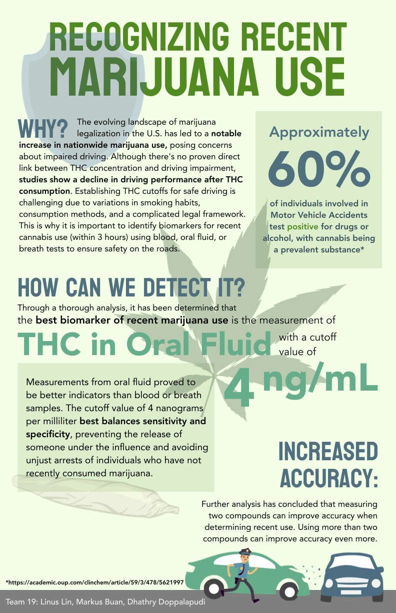
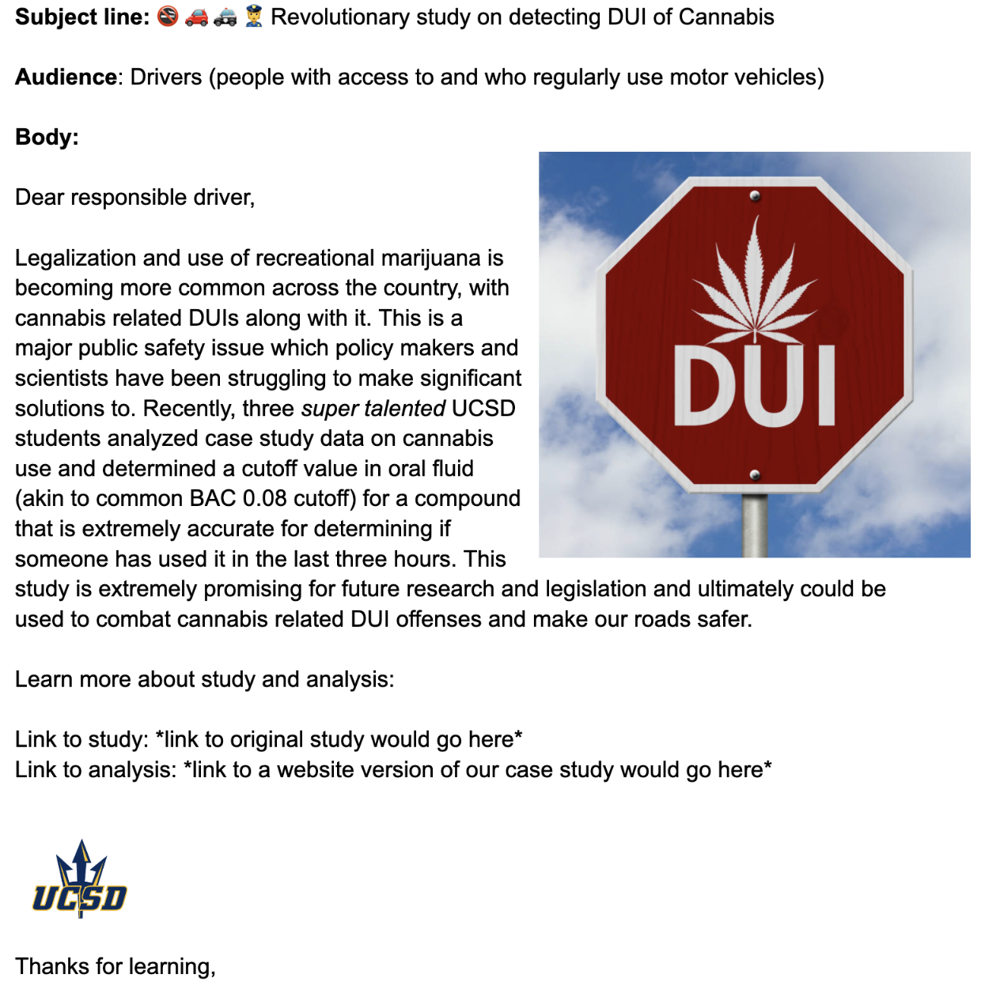

# CS01: In class {background-color="#92A86A"}

## Q&A {.scrollable .smaller}

::: {.callout-note collapse="true" title="Q: How exactly will we process EDA to our own style?"}
A: You can use my style (from a design perspective), but you'll need to make sure that 1) any plot you include in your final report is consistent (e.g. same colors for same groups) throughout your report and 2) make sure that whatever plots you include help tell your story ...and that your explanations alongside the plots help support the storytelling. You can also change style to match whatever your group decides. You are not required to use the style I provided.
:::

::: {.callout-note collapse="true" title="Q: I'm curious about different solutions people have come up with to find middleground between specificity and sensitivity."}
A: This is up to your group to discuss! What do you carea bout most? Or do you care about both equally? How have others (e.g. researchers) who have asked similar questions made this decision? You will need to decide and justify that decision.
:::

::: {.callout-note collapse="true" title="Q: Generally, people commented on complexity of code and plot readingn"}
A: Yes! This is intended. We've discussed it in class. You've explored it a bit in lab. Now it's time to really dig in....alongside other students...to put your brains together to understand and learn a bit deeper!
:::

## Course Announcements

**Due Dates**:

-   **Lab 05** due Fri 10/30 (11:59 PM)
-   **Mid-course survey** due Fri 10/30 (11:59 PM)
-   **CS01** (report in repo + general communication on Canvas) & 🔘 CS01 team eval survey due Sun 11/1 (11:59 PM)
-   Lecture Participation survey "due" after class

## CS01: Questions?

-   group work
-   GH
-   report completion
-   extension
-   how to effectively use GenAI to help?
-   ~~general communication~~ (hold these for now)

# General Communication {background-color="#92A86A"}

## Example: infographic

FA23 Group: Dhathry, Markus & Linus

## Example: email

## Example: IG-like slides

Link [here](https://www.canva.com/design/DAF1alZjz2Q/TsnYWt6FBRhD-pjVUh0kuA/view?utm_content=DAF1alZjz2Q&utm_campaign=designshare&utm_medium=link&utm_source=viewer)

## Example: Slides/Report



# CS01 Time {background-color="#92A86A"}

## Plan for today

::: incremental
-   Discuss/have a plan
-   Clear on tasks - division of labor; specific deadlines; assignments
  - First pass: background, data, Wrangling, Viz
  - Second pass/editing: switch roles [background, data] <> [wrangling, viz]
-   Make progress & discuss
-   Help one another
-   Recap at end & revisit plan, progress, and who's doing what/when
:::
