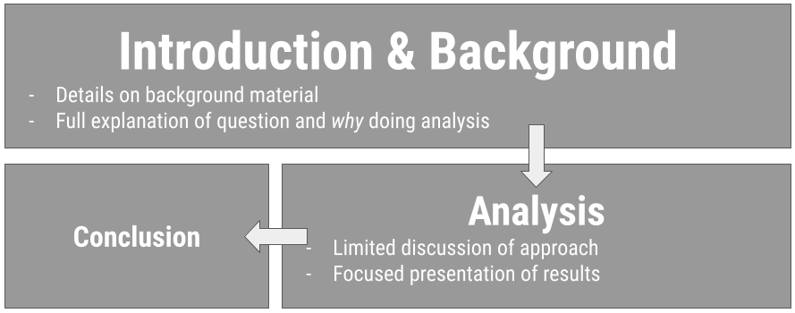
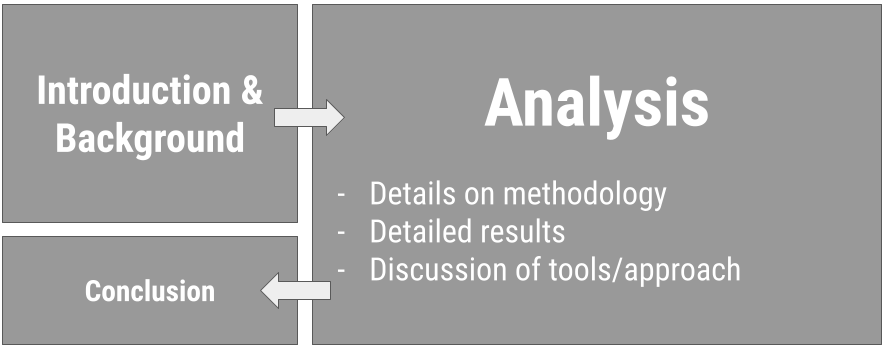
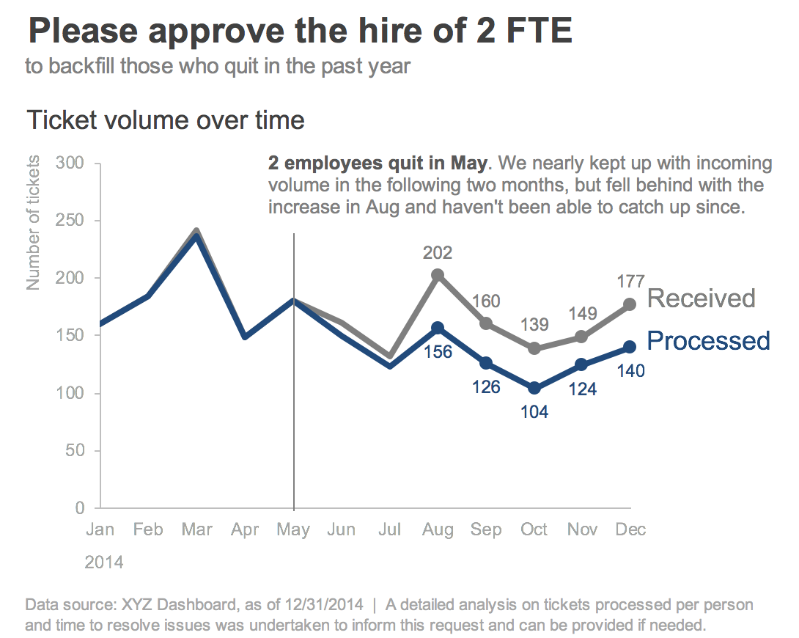

# Effective Written Communication {background-color="#92A86A"}

## Course Announcements

**Due Dates**:

- **Lab 05** due Fri 10/30 (11:59 PM)
- **[Mid-course survey](https://forms.gle/zcVKcGXRNkN8Zj4E7)** "due" Fri 10/30 (11:59 PM)
- **CS01** due Sunday (11:59 PM)
  - report in repo
  - General communication (Canvas)
  - [team eval survey](https://forms.gle/WsZUS4AGrRiWMCML7) 
- Lecture Participation survey "due" after class

Note:
- lab03 (check feedback on GH issue) and lab04 grades posted 


```{r packages, echo = FALSE, message=FALSE, warning=FALSE}
library(tidyverse)
library(emo)
library(knitr)
library(kableExtra)
library(googlesheets4)

# ggplot2 color palette with gray
color_palette <- list(gray = "#999999", 
                      salmon = "#E69F00", 
                      lightblue = "#56B4E9", 
                      green = "#009E73", 
                      yellow = "#F0E442", 
                      darkblue = "#0072B2", 
                      red = "#D55E00", 
                      purple = "#CC79A7")

knitr::opts_chunk$set(dpi = 300, echo=TRUE, warning=FALSE, message=FALSE) 
```

## Agenda

-   Communicating for your audience
-   Written Communication
-   Visual Communication

Note: We'll discuss oral communication closer to the end of the quarter, when you'll have to present out loud.

## Suggested Reading

-   Quarto: [Execution Options](https://quarto.org/docs/computations/execution-options.html) (code chunks & inline code)
-   Quarto: [HTML Basics](https://quarto.org/docs/output-formats/html-basics.html) and [HTML Code Blocks](https://quarto.org/docs/output-formats/html-code.html)


# Consider your audience {background-color="#92A86A"}

## What does this mean?

[`r emo::ji("question")` What does it mean to "consider your audience?"]{style="background-color: #ADD8E6"}

. . .

Simply: **You do the work so they don't have to.**

. . .

...also the [aesthetic-usability effect](https://lawsofux.com/aesthetic-usability-effect/) exists: people perceive polished, attractive work as easier to use (and are more forgiving of its flaws).

## What's the right level?

::: columns
::: {.column width="50%"}
**General Audience**\
✔ background\
🚫 limit technical details\
🎉 emphasize take-home\


:::

::: {.column width="50%"}
**Technical Audience**\
⬇ limit background\
💻 all-the-details\
🎉 emphasize take-home\


:::
:::

## Considerations

-   **Platform**: written? oral?

. . .

-   **Setting**: informal? formal?

. . .

-   **Audience**: technical? general? 

## Choose informative titles

In **written reports**: Balance b/w short and informative (goal: concise)

. . .

::: {.fragment .semi-fade-out}
Avoid: "Analyzing NHANES"
:::

Better: "Data from the NHANES study shows that diet is related to overall health"

. . .

On **visualizations**: emphasize the take-home! (what's learned or what action to take)

. . .

::: {.fragment .semi-fade-out}
Avoid: "Boxplot of gender"
:::

Better: "Twice as many females as males included for analysis"

. . .

::: {.fragment .semi-fade-out}
Avoid: "Tickets vs. Time"
:::

Better: "Staff unable to respond to incoming tickets; need to hire 2 FTEs"

# Effective Written Communication {background-color="#92A86A"}

## Benefits of written communication

Your audience has time to process...but the explanation has to be there!

. . .

Visually: more on a single visualization

. . .

Yes, often there are different visualizations for reports/papers than for presentations/lectures.

## When you have time to digest (read)



. . .

[`r emo::ji("question")` What makes this an effective visualization for a written communication?]{style="background-color: #ADD8E6"}

Source: [Storytelling with data](https://www.storytellingwithdata.com/book/downloads) by cole nussbaumer knaflic

## Written Explanations

-   Visualizations should be explained/interpreted
-   Analyses/Models should be explained
    -   should be clear what question is being answered
    -   what conclusion is being drawn
    -   and what numbers were used to draw that conclusion

## Data Science Reports in .qmd

::: incremental
-   As **concise** as possible
-   **Important information introduced** before referenced (datasets, jargon, etc.)
-   **Necessary details** (for your audience); nothing more
    -   Be sure that the rendered output contains what you intended (plots displayed; headers etc.)
    -   ...and does NOT display stuff that doesn't need to be there (messages/warnings suppressed, brainstorming, etc.)
-   Typical Sections: Introduction/Background, Setup, Data, Analysis, Conclusion, References
:::

## Controlling HTML document settings

-   Table of Contents

```         
---
title: "Document Title"
format:
  html:
    toc: true
    toc-depth: 3
---
```

. . .

-   Theme

```         
---
title: "Document Title"
format:
  html:
    theme: united
    highlight-style: tango
---
```

. . .

-   Figure Options

```         
---
title: "Document Title"
format:
  html:
    fig-width: 7
    fig-height: 6
---
```

. . .

-   Code Folding

```         
---
title: "Document Title"
format:
  html:
    code-fold: true
---
```

## Sharing your HTML

-   Self-contained output: everything (plots, CSS, JS) packed into a single `.html` file

```         
---
title: "Document Title"
format:
  html:
    embed-resources: true
---
```

. . .

-   Without this, your plots/styling live in a separate `_files/` folder...and break if the `.html` is shared/submitted on its own
-   Trade-off: larger file size

. . .

::: callout-warning
GitHub does **not** render `.html` files. Clicking your report on GitHub shows the source code. That's expected! It doesn't mean your render failed. Download the file and open it in a browser to check it.
:::

## Controlling code chunk output {.smaller}

-   Specified at the top of the chunk, one per line, with `#|`

```{{r}}
#| label: chunk-label
#| results: hide
#| fig-height: 4

```

. . .

-   `eval`: whether to execute the code chunk
-   `echo`: whether to include the code in the output
-   `include: false`: run the code, but show *nothing* (code or output) in the rendered document. Great for setup chunks (e.g., loading packages)
-   `warning`, `message`, and `error`: whether to show warnings, messages, or errors in the rendered document
-   `fig-width` and `fig-height`: control the width/height of plots
-   `fig-cap`: add a caption to a figure

. . .

-   Controlling for the whole document (in the YAML):

```         
---
title: "Document Title"
execute:
  warning: false
  message: false
---
```

## Inline code: numbers in your text

Typing numbers into your text by hand means they go stale (or are just wrong!) when your data or analysis changes.

Instead, compute them with inline code:

```markdown
The mtcars dataset includes `r knitr::inline_expr("nrow(mtcars)")` cars, with an average fuel efficiency of `r knitr::inline_expr("round(mean(mtcars$mpg), 1)")` mpg.
```

. . .

...which renders as:

> The mtcars dataset includes `r nrow(mtcars)` cars, with an average fuel efficiency of `r round(mean(mtcars$mpg), 1)` mpg.

. . .

The numbers in your conclusions are *always* the numbers from your analysis.

## Editing & Proofreading

-   Did you end up telling a story?
    -   Things missing?
    -   Things to delete?

. . .

-   Do not fall in love with your words/code/plots

. . .

-   Do spell check
-   Do read it over before sending/presenting/submitting

## Aside: Citing Sources {.smaller}

**When are citations needed?**

. . .

::: {.fragment .semi-fade-out}
> "We will be doing our analysis using two different data sets created by two different groups: Donohue and Mustard + Lott, or simply Lott"
:::


. . .

::: {.fragment .semi-fade-out}
> "Right to Carry Laws refer to laws that specify how citizens are allowed to carry concealed handguns when they're away from home without a permit"
:::

. . .

::: {.fragment .semi-fade-out}
> "In this case study, we are examining the relationship between unemployment rate, poverty rate, police staffing, and violent crime rate."
:::

. . .

::: {.fragment .semi-fade-out}
> "In the United States, the second amendment permits the right to bear arms, and this law has not been changed since its creation in 1791."
:::

. . .

::: {.fragment .semi-fade-out}
> "The Right to Carry Laws (RTC) is defined as"a law that specifies if and how citizens are allowed to have a firearm on their person or nearby in public.""
:::

. . .

**Reminder**: You do NOT get docked points for citing others' work. You can be at risk of an Academic Integrity violation if you don't. **When in doubt, give credit.**

## Footnotes in .qmd

How to specify a footnote in text:

```markdown
Here is some body text.[^1]
```

How to include the footnote's reference:

```markdown
[^1]: This footnote will appear at the bottom of the page.
```

::: aside
Note: .bib files can be included with BibTeX references using the `bibliography` parameter in your YAML
:::

## Effective GenAI Strategies

[`r emo::ji("question")` While generating your first draft, how can GenAI be helpful?]{style="background-color: #ADD8E6"}

[`r emo::ji("question")` After you have a first draft, how can GenAI be helpful?]{style="background-color: #ADD8E6"}

[`r emo::ji("question")` While completing your cs01, what to avoid with GenAI?]{style="background-color: #ADD8E6"}


# Effective Visual Communication {background-color="#92A86A"}

## The *Glamour* of Graphics

-   builds on top of the grammar (*components*) of a graphic
-   considerations for the *design* of a graphic
-   color, typography, layout
-   going from 😬accurate to 😍effective

::: aside
These ideas and slides are all modified from Will Chase's rstudio::conf2020 [slides](https://www.williamrchase.com/slides/assets/player/KeynoteDHTMLPlayer.html)/talk
:::

. . .

The following example uses the `penguins` dataset from the `palmerpenguins` package (would have to be installed to run these.)

```{r}
library(palmerpenguins)
```

## An Example...

::: panel-tabset
### 😬 Accurate

```{r}


ggplot(penguins, aes(x = species, fill = species)) +
  geom_bar() +
  labs(title = "Count vs. Species") +
  theme(axis.text.x = element_text(angle = 90, vjust = 0.5, hjust = 1))
```

### 😍 Effective

```{r}
ggplot(penguins, aes(y = fct_rev(fct_infreq(species)), fill = species)) +
  geom_bar() +
  geom_text(stat='count', aes(label=after_stat(count)), hjust = 1.5, color = "white", size = 7) +
  scale_x_continuous(expand = c(0, 0)) +
  scale_fill_manual(values = c("#454545", rep("#adadad", 2))) +
  labs(title = "Adelie Penguins are the most common in Antarctica", 
       subtitle = "Frequency of each penguin species studied near Palmer Station, Antarctica") +
  theme_minimal(base_size = 14) +
  theme(axis.text.x = element_blank(),
        plot.title.position = "plot", 
        panel.grid.major = element_blank(), panel.grid.minor = element_blank(),
        axis.title = element_blank(),
        legend.position = "none")
```

### Changes

-   Informative Titles
-   Left Align Titles
-   Borders & Backgrounds: 👎
-   Organize & Remove/Lighten as much as possible
-   Direct labels > legends
-   Avoid head-tilting

::: callout-note
A reminder that when you're doing EDA, you're going to generate a lot of plots. Don't spend your time making all of them beautiful. Save that for the "editing" portion of your case study. Once you know which are needed to tell your story, add them in.
:::
::: 


## Tables are communication, too

::: panel-tabset
### 😬 Accurate

```{r}
penguins |>
  group_by(species) |>
  summarize(n = n(),
            mean_mass = mean(body_mass_g, na.rm = TRUE),
            mean_flipper = mean(flipper_length_mm, na.rm = TRUE))
```

### 😍 Effective

```{r}
penguins |>
  group_by(species) |>
  summarize(n = n(),
            mean_mass = mean(body_mass_g, na.rm = TRUE),
            mean_flipper = mean(flipper_length_mm, na.rm = TRUE)) |>
  arrange(desc(n)) |>
  kable(col.names = c("Species", "N", "Body mass (g)", "Flipper length (mm)"),
        digits = 0,
        format.args = list(big.mark = ","),
        caption = "Gentoo penguins are the largest, despite Adelie being most common") |>
  kable_styling(full_width = FALSE)
```

### Changes

-   Informative caption (the take-home, like a plot title)
-   Human-readable column names (with units!)
-   Sensible rounding: `33.6234` is rarely more useful than `34`
-   Ordered rows
-   No raw R output (`# A tibble: 3 x 4`, `<fct>`, `<dbl>`) in a report
:::

## Recap {background-color="#92A86A"}

-   Tailor communication for setting and audience
-   Written communication has benefit of time; limitation of additional explanation
-   Can you control your HTML output from a .qmd document?
-   Can you use inline code to keep numbers in your text accurate?
-   Do you know when to cite a source?
-   Can you implement design choices when generating visualizations for communication?
