```{r packages, echo = FALSE, message=FALSE, warning=FALSE}
library(tidyverse)
library(emo)

knitr::opts_chunk$set(dpi = 300, echo=TRUE, warning=FALSE, message=FALSE) 
```

## Q&A {.scrollable .smaller}

<!-- Copy this box once per question. Put the question after "Q:" in the title and your answer in the body. -->

::: {.callout-note collapse="true" title="Q: "}
A:
:::

## Course Announcements

**Due Dates**:

-   ⌨️ **Lab 04** due Fri 10/30 (11:59 PM)
-   💻 **CS01** (report in repo + general communication on Canvas) & 🔘 CS01 team eval survey due Fri 10/30 (11:59 PM)
-   🔘 **Mid-course survey** due Fri 10/30 (11:59 PM)
-   📄 **Final Project Proposal** due Wed 11/4 (11:59 PM)
-   🔘 Lecture Participation survey "due" after class

```{=html}
<!-- FA24 announcements, kept for reference:
**Due Dates**:

-   `r emo::ji("computer")` **CS01** due Wednesday
-   `r emo::ji("science")` **Lab 05** due Thursday
-   🔘 **CS01 Team Eval** survey due Thursday
-   📄 **Final Project Proposal** due Monday
-   `r emo::ji('clipboard')` Lecture Participation survey "due" after class


Notes:

- hw02 and lab04 feedback and scores posted
- mid-course survey open until tonight
-->
```
## Mid-course survey (N=55; 57%)

Generally, things are going well, pacing is ok, and people are getting their questions answered.

Some great suggestions:

-   Give us time in class to meet groups right after assignment
-   Keep instructions in same document for completion
-   More text in notes
-   More cs01 guidance/time
-   include some details about R in the wild

# Planning Ahead {background-color="#92A86A"}

## Group Formation (CS02 + Final Project)

::: incremental
-   CS02 and Final Project are completed in groups (4-5) that you choose
    -   CS02 - we choose the topic
    -   Final project - you choose the topic
-   You specify that group by submitting your final project proposal (due Monday)
-   I will create repos for CS02 and final project after proposals are submitted
-   You will still submit feedback about your experience working with your group
:::

. . .

The final project proposal [link](https://docs.google.com/forms/d/e/1FAIpQLSfXBztrZuK0CeB8p3YZWr6M37oe16DGazuow7_g9Ulr6AiyXg/viewform?usp=sf_link)

## Final Project

Carry out a data analysis on a topic and dataset of your choosing

::: incremental
-   not something that has already been done
-   pick a topic you care about
-   asking and answering a small-ish, specific question OR building a model to complete a useful task
:::

. . .

**Components**

-   Proposal \| week 7
-   Rough Draft of report \| week 9
-   Peer Feedback \| week 10
-   Final Deliverable \| Tues of finals week
    -   report (.qmd -\> html)
    -   3-5 min presentation\*
    -   general audience communication

. . .

Notes:

::: incremental
-   Groups will have the option to record their presentation or present in class during week 10 (EC; all group members must present)
-   CS02 is also due week 9; these will be happening concurrently; that's why you're in the same group
:::

## Topic Brainstorming

Let's brainstorm some topics together...

# HW02 (revisited) · replace with FA26 examples {background-color="#92A86A"}

## Part I: Imitation

## Fight Songs

::: panel-tabset
### Original


### Plot (Sailor)

```{r ref.label="C", echo = FALSE, out.width="100%"}
```

### Code (Sailor)

```{r C, fig.show = "hide"}
fight <- read_csv('data/fight-songs.csv', show_col_types = FALSE)
 
# Calculate avg_duration and avg_bpm across fight songs for classifying
avg_duration <- mean(fight$sec_duration, na.rm = TRUE)
avg_bpm <- mean(fight$bpm, na.rm = TRUE)

# Begin ggplot
ggplot(fight, aes(x = sec_duration, y = bpm)) +
  
  # Making sure Notre Dame is colored and referenced differently 
  geom_point(aes(color = ifelse(school == "Notre Dame", "Notre Dame", factor(school))), size = 5, alpha = 0.5) +
  scale_color_hue() +
  geom_vline(xintercept = avg_duration, linetype = "dotted", color = "black", size = 0.7) +
  geom_hline(yintercept = avg_bpm, linetype = "dotted", color = "black", size = 0.7) +
   annotate("text", x = avg_duration + 5, y = 100, label = "AVERAGE", angle = 90, vjust = -0.5, size = 3.5)  +
  # Adding in my labels for quadrants + AVERAGE
  annotate("text", x = 0, y = avg_bpm + 5, label = "AVERAGE", hjust = -0.5, size = 3.5) +
  annotate("text", x = 30, y = 190, label = "Fast and short", size = 4) +
  annotate("text", x = 130, y = 190, label = "Fast but long", size = 4) +
  annotate("text", x = 30, y = 60, label = "Slow but short", size = 4) +
  annotate("text", x = 130, y = 60, label = "Slow and long", size = 4) +
  geom_point(aes(x = 60, y = 150), color = "black", size = 5) +
  annotate("text", x = 60, y = 150, label = "Notre Dame", vjust = -1.5, fontface = "bold") +
  labs(x = "Duration", y = "Beats per minute") +
  
  # Scale my axis to adjust to match original 
  
  scale_x_continuous(breaks = seq(0, 180, by = 20)) +
  scale_y_continuous(breaks = seq(40, 200, by = 20), limits = c(40, 200)) +
  coord_fixed(ratio = 0.8) +  
  theme_minimal() +
  # Theme adjusting 
  
  theme(
    plot.margin = margin(t = 10, r = 10, b = 10, l = 20),
    legend.position = "none",
    panel.grid.minor = element_line(color = "grey90", linetype = "solid"),
    panel.grid.major = element_line(color = "grey80", linetype = "solid"),
    panel.border = element_rect(color = "black", fill = NA))
```

### Plot (v2)

```{r ref.label="D", echo = FALSE, out.width="100%"}
```

### Code (v2)

```{r D, fig.show = "hide"}
fight_songs_data <- fight
mean_bpm <- mean(fight_songs_data$bpm, na.rm = TRUE)
mean_duration <- mean(fight_songs_data$sec_duration, na.rm = TRUE)

ggplot(fight_songs_data, aes(x = sec_duration, y = bpm)) +
    geom_point(aes(color = school), alpha = 0.2, size = 5) +
    geom_vline(xintercept = mean_duration, linetype = "dotted", color = "black") +
    geom_hline(yintercept = mean_bpm, linetype = "dotted", color = "black") +
    geom_point(data = filter(fight_songs_data, school == "Stanford"), 
               aes(x = sec_duration, y = bpm), 
               color = "red", size = 5, shape = 21, fill = "red") +
    geom_text(data = filter(fight_songs_data, school == "Stanford"), 
              aes(x = sec_duration, y = bpm, label = "Stanford", fontface = "bold", family = "Arial"), 
              vjust = -1, color = "black", size = 4) +
    labs(
        title = "How Stanford's Fight Song stacks up",
        x = "Duration",
        y = "Beats per minute"
    ) +
    scale_y_continuous(breaks = seq(60, 200, by = 20),
                       labels = c("60", "80", "100", "120", "140", "160", "180", "200bpm"),
                       limits = c(60, 200)) +
    scale_x_continuous(breaks = seq(0, 180, by = 20), 
                       labels = c("0 sec", "20", "40", "60", "80", "100", "120", "140", "160", "180")) +
    annotate("text", x = 10, y = 190, label = "Fast and short", size = 4, hjust = 0, family = "Courier") +
    annotate("text", x = 10, y = 70, label = "Slow but short", size = 4, hjust = 0, family = "Courier") +
    annotate("text", x = 140, y = 190, label = "Fast but long", size = 4, hjust = 1, family = "Courier") +
    annotate("text", x = 140, y = 70, label = "Slow and long", size = 4, hjust = 1, family = "Courier") +
    annotate("text", x = max(fight_songs_data$sec_duration) - 20, y = mean_bpm, 
             label = "AVERAGE", vjust = 0.5, hjust = -0.1, color = "black", size = 3, family = "Arial") +
    theme_minimal() +
    theme(
        legend.position = "none",
        plot.title = element_text(hjust = 0.5, face = "bold", family = "Arial"),
        panel.grid.major = element_line(size = 0.5),
        panel.grid.minor = element_blank()
    )
```
:::

## Hate Crimes (Adam)

::: panel-tabset
### Original


### Plot

```{r ref.label="Adam", echo = FALSE, out.width="100%"}
```

### Code

```{r Adam, fig.show = "hide"}
# Load data
url <- "https://raw.githubusercontent.com/fivethirtyeight/data/master/hate-crimes/hate_crimes.csv"
hate_crimes <- read_csv(url)

states_map <- map_data("state")
hate_crimes <- hate_crimes |>
  mutate(state = tolower(state)) 

map_data <- states_map |>
  left_join(hate_crimes, by = c("region" = "state"))


#Graph Numero Uno

ggplot(map_data, aes(x = long, y = lat, group = group, fill = avg_hatecrimes_per_100k_fbi)) +
  geom_polygon(color = "white") +
  scale_fill_gradient(low = "#ffe4d0", high = "#ba3900", na.value = "gray", name = "Hate Crimes\nper 100k") +
  labs(title = "PRE-ELECTION HATE CRIME RATES POST-ELECTION",
       subtitle = "Average annual hate crimes per 100,000 residents, 2010-15") +
  theme_minimal() +
  theme(    axis.text.x = element_blank(),
    plot.title = element_text(face = 'bold'),
    axis.ticks.x = element_blank(),
    axis.text.y = element_blank(),
    axis.ticks.y = element_blank(),
    axis.title.x = element_blank(),
    axis.title.y = element_blank(),
    panel.grid = element_blank(),
    legend.position = "top", 
    legend.title = element_text(size=6),
    
  ) +
  coord_fixed(1.3) #Unstretch

#Second Graph
ggplot(map_data, aes(x = long, y = lat, group = group, fill = hate_crimes_per_100k_splc)) +
  geom_polygon(color = "white") +
  scale_fill_gradient(low = "#b0e2c8", high = "#006646", na.value = "gray", name = "Hate Crimes\nper 100k") +
  labs(title = "POST-ELECTION HATE CRIME RATES POST-ELECTION",
       subtitle = "Average annual hate crimes per 100,000 residents, 2010-15") +
  theme_minimal() +
  theme(    axis.text.x = element_blank(),
    plot.title = element_text(face = 'bold'),
    axis.ticks.x = element_blank(),
    axis.text.y = element_blank(),
    axis.ticks.y = element_blank(),
    axis.title.x = element_blank(),
    axis.title.y = element_blank(),
    panel.grid = element_blank(),
    legend.position = "top", 
    legend.title = element_text(size=6),
    
  ) +
  coord_fixed(1.3) #Unstretch
```
:::

## Congress Age

::: panel-tabset
### Original


### Plot

```{r ref.label="Congress", echo = FALSE, out.width="100%"}
```

### Code

```{r Congress, fig.show = "hide"}
congress_data = read_csv("data/data_aging_congress.csv")

congress_data <- congress_data |>
  mutate(year = as.numeric(format(start_date, "%Y")))  #Extracted year from start_date

#Grouping Congress by session to calculate median age
congress_median_age <- congress_data |>
  group_by(congress, year, chamber) |>
  summarise(median_age = median(age_years, na.rm = TRUE)) |>
  ungroup()

ggplot(congress_median_age, aes(x = year, y = median_age, color = chamber)) +
  geom_step(linewidth = 1) +  
  #Senate
  geom_text(data = congress_median_age |> 
              filter(chamber == "Senate", year == 2023),  
            aes(label = "65.3"), 
            hjust = -0.2, vjust = +0.3, size = 3, color = "black", show.legend = FALSE) + 
  #House
  geom_text(data = congress_median_age |> 
              filter(chamber == "House", year == 2023), 
            aes(label = "57.8"), 
            hjust = -0.2, vjust = -0.5, size = 3, color = "black", show.legend = FALSE) +
  #Titles
  labs(title = "Median Age of the U.S. Senate and House by Congress, 1919 to 2023",
       subtitle = "The House and Senate are older than ever before",
       x = "Year",
       y = "Median Age",
       color = "Chamber") +  
    scale_color_manual(values = c("Senate" = "#5b41d1", "House" = "#55aa5c"))+
  #Scaling both axis
  scale_x_continuous(limits = c(min(congress_median_age$year), max(congress_median_age$year)), breaks = seq(1920, 2020, by =  10)) +
  scale_y_continuous(limits = c(45, NA)) +
  theme_minimal() +  
  theme(plot.title = element_text(face = "bold", size = 14),  
        plot.subtitle = element_text(size = 10),
        axis.title = element_text(size = 12),
        legend.position = "top",
        aspect.ratio = 1/4,
        panel.grid.major.x = element_blank(),
        panel.grid.minor.x = element_blank(),
        panel.grid.minor.y = element_blank())
```
:::

## Part II: Sad Plot

## Votes

::: panel-tabset
### Original


### Plot

```{r ref.label="sad", echo = FALSE, out.width="100%"}
```

### Code

```{r sad, fig.show = "hide"}
# estimate data
d <- data.frame(
  area = rep(c('Rural', 'Suburban', 'Urban'), each = 2),
  voted = rep(c('Biden', 'Trump'), times = 3),
  percentages = c(35, 65, 55, 45, 70, 30)
)

# plot

ggplot(d, aes(x = area, y = percentages, fill = voted)) +
  geom_bar(stat = "identity", position = "dodge") +
  labs(
    title = "Votes for Trump and Biden in 2020 Elecxtion Based on Location",
    x = "Location",
    y = "Percentage of Votes",
    fill = "Candidate"  # Legend title
  ) +
  scale_y_continuous(breaks = seq(0, 100, by = 10), limits = c(0, 80)) +
  theme_minimal() +
  scale_fill_manual(values = c("#0033A0", "#C8102E"))  # Custom colors for groups
```
:::

## CS01 Data (Sandy)

::: panel-tabset
### Original


### Plot

```{r ref.label="cs01", echo = FALSE, out.width="100%"}
```

### Code

```{r cs01, fig.show = "hide"}
WB <- read_csv("data/Blood.csv")

WB <- WB |> 
  mutate(Treatment = fct_recode(Treatment, 
                                "5.9% THC (low dose)" = "5.90%",
                                "13.4% THC (high dose)" = "13.40%"),
         Treatment = fct_relevel(Treatment, "Placebo", "5.9% THC (low dose)"),
         Group = fct_recode(Group,
                            "Frequent User" = "Frequent user",
                            "Occasional User" = "Occasional user")) |> 
  janitor::clean_names() |>
  rename(thcoh = x11_oh_thc,
         thccooh = thc_cooh,
         thccooh_gluc = thc_cooh_gluc,
         thcv = thc_v) |>
  mutate(timepoint = case_when(time_from_start < 0 ~ "pre-smoking",
                               time_from_start > 0 & time_from_start <= 30 ~ "0-30 min",
                               time_from_start > 30 & time_from_start <= 70 ~ "31-70 min",
                               time_from_start > 70 & time_from_start <= 100 ~ "71-100 min",
                               time_from_start > 100 & time_from_start <= 180 ~ "101-180 min",
                               time_from_start > 180 & time_from_start <= 210 ~ "181-210 min",
                               time_from_start > 210 & time_from_start <= 240 ~ "211-240 min",
                               time_from_start > 240 & time_from_start <= 270 ~ "241-270 min",
                               time_from_start > 270 & time_from_start <= 300 ~ "271-300 min",
                               time_from_start > 300 ~ "301+ min"))

WB |>
  ggplot(mapping = aes(x = time_from_start,
                       y = thccooh,
                       color = group)) +
  geom_point(size = 3) +
  labs(x = "Time After Smoking (Minutes)", y = "THCCOOH", 
       title = "Change in THCCOOH Levels After Smoking",
       subtitle = "Levels measured over time for frequent and occasional users",
       color = "Group") +
  theme(plot.title = element_text(size = 20, hjust = 0, vjust = 2),
        plot.subtitle = element_text(size = 16, hjust = 0, vjust = 1)) +
  scale_color_manual(values = c("Frequent User" = "#fc8d59",
                                "Occasional User" = "#91bfdb")) +
  theme_minimal()
```
:::

# CS02: Predicting Air Pollution (Data) {background-color="#92A86A"}

## Agenda

-   Background (pollutants, health impacts)
-   Question
-   Data Intro

# Background {background-color="#92A86A"}

## Why?

[<i class="fa fa-user" aria-hidden="true"></i>   Why do we discuss background on case studies?]{style="background-color: #ADD8E6"}

## OpenCaseStudies

Wright, Carrie and Meng, Qier and Jager, Leah and Taub, Margaret and Hicks, Stephanie. (2020). [https://github.com//opencasestudies/ocs-bp-air-pollution](https://www.opencasestudies.org/ocs-bp-air-pollution/). Predicting Annual Air Pollution (Version v1.0.0).

## Air Pollutants

Some sources are natural while others are anthropogenic (human-derived):

<p align="center">

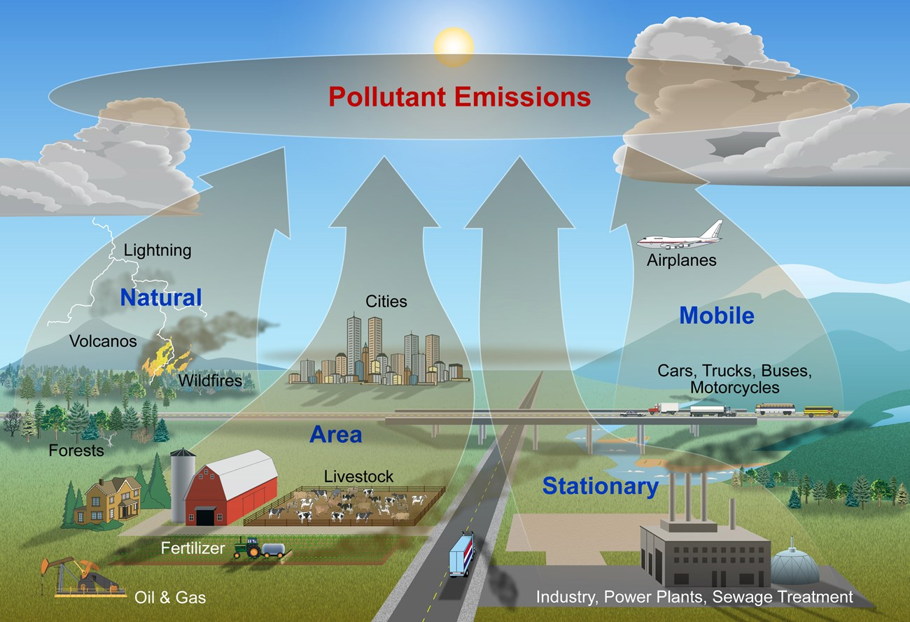

</p>

[\[source\]](https://www.google.com/url?sa=i&url=https%3A%2F%2Fwww.nps.gov%2Fsubjects%2Fair%2Fsources.htm&psig=AOvVaw2v7AVxSF8ZSAPEhNudVtbN&ust=1585770966217000&source=images&cd=vfe&ved=0CAIQjRxqFwoTCPDN66q_xegCFQAAAAAdAAAAABAD){target="_blank"}

## Major types of air pollutants

1)  **Gaseous** - Carbon Monoxide (CO), Ozone (O~3~), Nitrogen Oxides(NO, NO~2~), Sulfur Dioxide (SO~2~)
2)  **Particulate** - small liquids and solids suspended in the air (includes lead- can include certain types of dust)
3)  **Dust** - small solids (larger than particulates) that can be suspended in the air for some time but eventually settle
4)  **Biological** - pollen, bacteria, viruses, mold spores

See [here](http://www.redlogenv.com/worker-safety/part-1-dust-and-particulate-matter) for more detail on the types of pollutants in the air.

## Particulate Pollution

Air pollution particulates are generally described by their **size**:

1)  **Large Coarse** Particulate Matter - has diameter of \>10 micrometers (10 µm)

2)  **Coarse** Particulate Matter (called **PM~10-2.5~**) - has diameter of between 2.5 µm and 10 µm

3)  **Fine** Particulate Matter (called **PM~2.5~**) - has diameter of \< 2.5 µm

**PM~10~** includes any particulate matter \<10 µm (both coarse and fine particulate matter)

. . .

In relation to a piece of human hair:

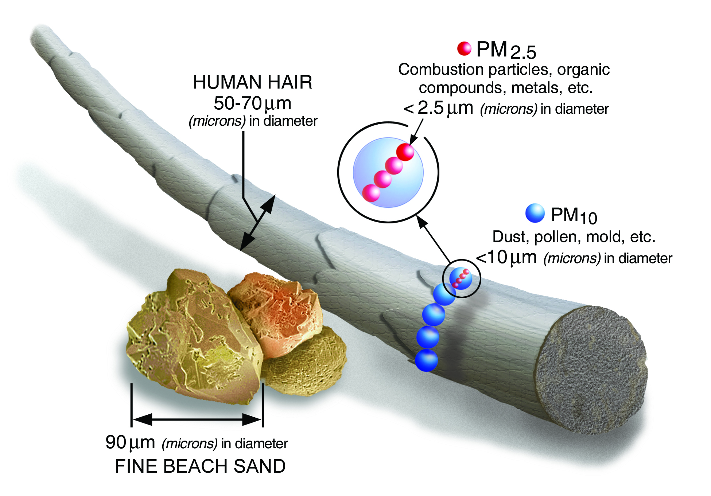

[\[source\]](https://www.epa.gov/pm-pollution/particulate-matter-pm-basics){target="_blank"}

. . .

[<i class="fa fa-brain" aria-hidden="true"></i>   Which do you think is most detrimental to our health? (and why?)]{style="background-color: #ADD8E6"}

## Common Pollutants and their size

<p align="center">

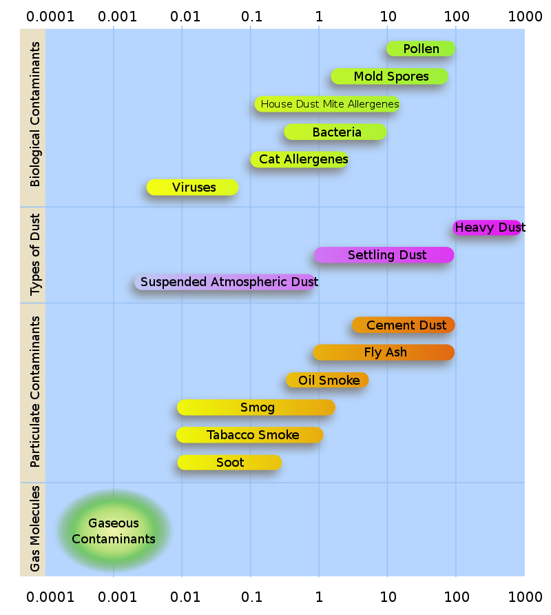

</p>

[\[source\]](https://en.wikipedia.org/wiki/Particulates){target="_blank"}

## Penetration into the human body

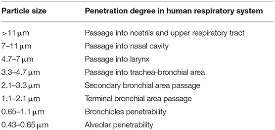

[\[source\]](https://www.frontiersin.org/articles/10.3389/fpubh.2020.00014/full){target="_blank"}

## Negative Health Impacts

Exposure to air pollution is:

-   associated with higher rates of [mortality](https://www.ncbi.nlm.nih.gov/pmc/articles/PMC5783186/){target="_blank"} in older adults
-   known to be a risk factor for many diseases and conditions including (but not limited to):

::: incremental
1)  [Asthma](https://www.ncbi.nlm.nih.gov/pubmed/29243937){target="_blank"} - fine particle exposure (**PM~2.5~**) was found to be associated with higher rates of asthma in children
2)  [Inflammation in type 1 diabetes](https://www.ncbi.nlm.nih.gov/pubmed/31419765){target="_blank"} - fine particle exposure (**PM~2.5~**) from traffic-related air pollution was associated with increased measures of inflammatory markers in youths with Type 1 diabetes
3)  [Lung function and emphysema](https://www.ncbi.nlm.nih.gov/pubmed/31408135){target="_blank"} - higher concentrations of ozone (O~3~), nitrogen oxides (NO~x~), black carbon, and fine particle exposure **PM~2.5~** , at study baseline were significantly associated with greater increases in percent emphysema per 10 years
4)  [Low birthweight](https://www.ncbi.nlm.nih.gov/pubmed/31386643){target="_blank"} - fine particle exposure(**PM~2.5~**) was associated with lower birth weight in full-term live births
5)  [Viral Infection](https://www.tandfonline.com/doi/full/10.1080/08958370701665434){target="_blank"} - higher rates of infection and increased severity of infection are associated with higher exposures to pollution levels including fine particle exposure (**PM~2.5~**)
:::

See this [review article](https://www.frontiersin.org/articles/10.3389/fpubh.2020.00014/full){target="_blank"} for more information about sources of air pollution and the influence of air pollution on health.

## Why to Care: The State of Global Air

The [State of Global Air](https://www.stateofglobalair.org/){target="_blank"} is a report released every year to communicate the impact of air pollution on public health.

. . .

The [State of Global Air 2019 report](https://www.stateofglobalair.org/sites/default/files/soga_2019_report.pdf){target="_blank"} (which uses data from 2017) stated that:

> Air pollution is the **fifth** leading risk factor for mortality worldwide. It is responsible for more deaths than many better-known risk factors such as malnutrition, alcohol use, and physical inactivity. Each year, **more** people die from air pollution–related disease than from road **traffic injuries** or **malaria**.

<p align="center">


</p>

[\[source\]](https://www.stateofglobalair.org/sites/default/files/soga_2019_report.pdf){target="_blank"}

. . .

> In 2017, air pollution is estimated to have contributed to close to 5 million deaths globally — nearly **1 in every 10 deaths**.

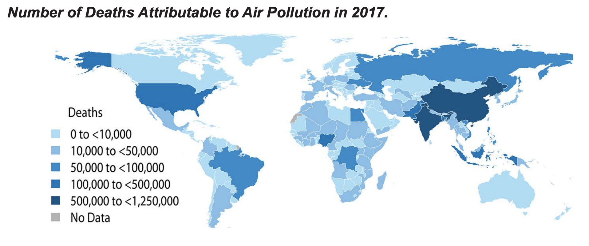

[\[source\]](https://www.stateofglobalair.org/sites/default/files/soga_2019_fact_sheet.pdf){target="_blank"}

. . .

The [State of Global Air 2018 report](https://www.stateofglobalair.org/sites/default/files/soga-2018-report.pdf){target="_blank"} (using data from 2016) separated different types of air pollution & found that **particulate pollution was particularly associated with mortality**.

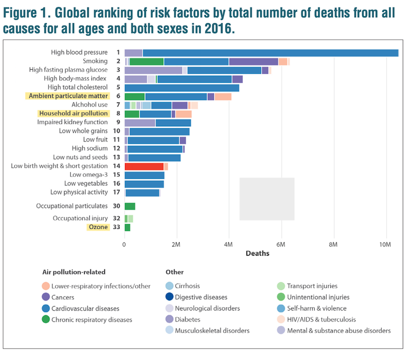

[\[source\]](https://www.stateofglobalair.org/sites/default/files/soga-2018-report.pdf){target="_blank"}

. . .

The 2019 report shows that the highest levels of fine particulate pollution occur in Africa and Asia and that:

> More than **90%** of people worldwide live in areas **exceeding** the World Health Organization (WHO) **Guideline** for healthy air. More than half live in areas that do not even meet WHO's least-stringent air quality target.

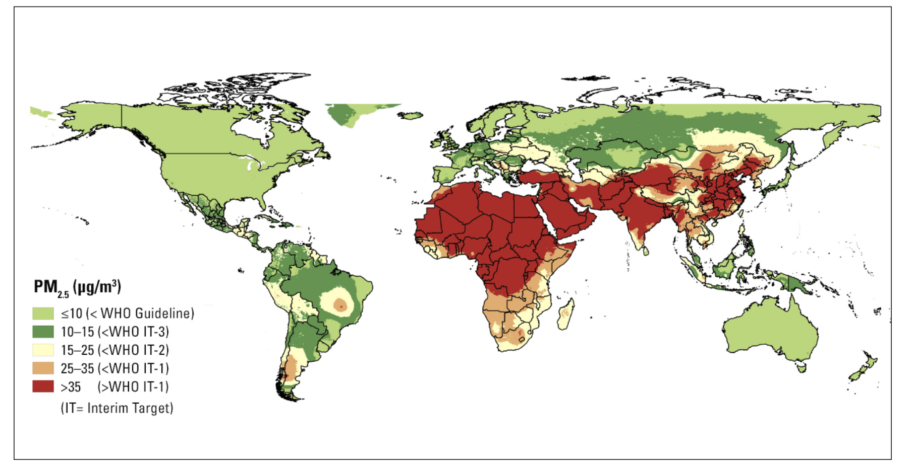

[\[source\]](https://www.stateofglobalair.org/sites/default/files/soga_2019_fact_sheet.pdf){target="_blank"}

## Overall Improvement

Looking at the US specifically, air pollution levels are generally improving, with declining national air pollutant concentration averages as shown from the 2019 [*Our Nation's Air*](https://gispub.epa.gov/air/trendsreport/2019/#home){target="_blank"} report from the US Environmental Protection Agency (EPA):

<p align="center">

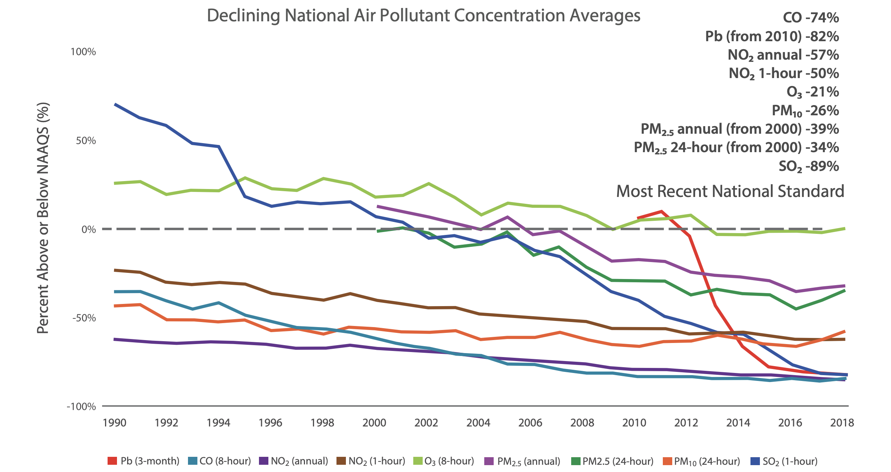

</p>

[\[source\]](https://gispub.epa.gov/air/trendsreport/2019/documentation/AirTrends_Flyer.pdf){target="_blank"}

## Still An Issue

-   air pollution **continues to contribute to health risk for Americans**, in particular in **regions with higher than national average rates** of pollution that, at times, exceed the WHO's recommended level.
-   important to obtain high spatial granularity in estimates of air pollution in order to identify locations where populations are experiencing harmful levels of exposure.

. . .

You can see that current air quality conditions at this [website](https://aqicn.org/city/usa/){target="_blank"}, and you will notice variation across different cities.

. . .

-   reports particulate values using what is called the [Air Quality Index](https://www.airnow.gov/index.cfm?action=aqibasics.aqi){target="_blank"} (AQI).
-   This [calculator](https://airnow.gov/index.cfm?action=airnow.calculator){target="_blank"} indicates that 138 AQI is equivalent to 50.5 ug/m^3^ and is considered unhealthy for sensitive individuals.
-   Thus, some areas exceed the WHO annual exposure guideline (10 ug/m^3^), and this may adversely affect the health of people living in these locations.

## Adverse health effects

-   Adverse health effects have been associated with populations experiencing higher pollution exposure despite the levels being below suggested guidelines.
-   it appears that the composition of the particulate matter and the influence of other demographic factors may make specific populations more at risk for adverse health effects due to air pollution. (For example, see this [article](https://www.nejm.org/doi/full/10.1056/NEJMoa1702747){target="_blank"} for more details.)

## Sparse monitoring PH issue

::: incremental
-   Historically, epidemiological studies would assess the influence of air pollution on health outcomes by relying on a number of monitors located around the country.
-   However, these monitors are relatively sparse in certain regions of the country and are not necessarily located near pollution sources.
-   dramatic differences in pollution rates can be seen even within the same city. (In fact, the term micro-environments describes environments within cities or counties which may vary greatly from one block to another.)
:::

. . .

<p align="center">

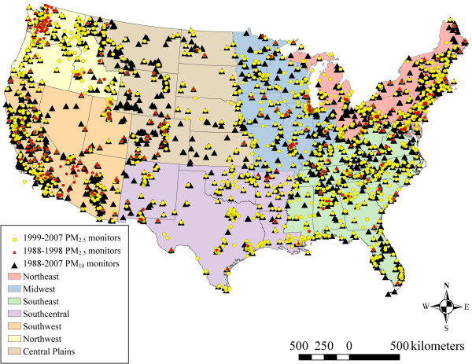

</p>

[\[source\]](https://ehjournal.biomedcentral.com/articles/10.1186/1476-069X-13-63){target="_blank"}

. . .

Lack of granularity in air pollution monitoring has hindered our ability to discern the full impact of air pollution on health and to identify at-risk locations.

## Machine Learning offers a solution

An [article](https://ehjournal.biomedcentral.com/articles/10.1186/1476-069X-13-63){target="_blank"} published in the *Environmental Health* journal dealt with this issue by using data, including population density and road density, among other features, to model or predict air pollution levels at a more localized scale using machine learning (ML) methods.

<p align="center">

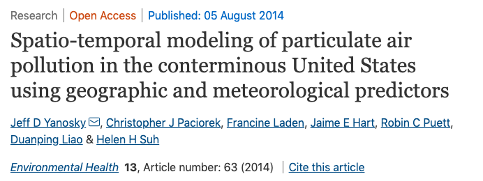

</p>

[\[source\]](https://ehjournal.biomedcentral.com/articles/10.1186/1476-069X-13-63){target="_blank"}

. . .

The authors of this article state that:

> "Exposure to atmospheric particulate matter (PM) remains an important public health concern, although it remains difficult to quantify accurately across large geographic areas with sufficiently high spatial resolution. Recent epidemiologic analyses have demonstrated the importance of spatially- and temporally-resolved exposure estimates, which show larger PM-mediated health effects as compared to nearest monitor or county-specific ambient concentrations."

. . .

The article above demonstrates that machine learning methods can be used to predict air pollution levels when traditional monitoring systems are not available in a particular area or when there is not enough spatial granularity with current monitoring systems.

. . .

So...we're going to do the same

# Question {background-color="#92A86A"}

> With what accuracy can we predict US annual average air pollution concentrations?

This will specifically be at the granularity of zip code regional levels using predictors such as data about population density, urbanization, road density, as well as, satellite pollution data and chemical modeling data.

# Data {background-color="#92A86A"}

## Monitor Data

::: incremental
-   Monitor data in this case study come from a system of monitors in which roughly 90% are located within cities.
-   There is an **equity issue** in terms of capturing the air pollution levels of more rural areas.
-   To get a better sense of the pollution exposures for the individuals living in these areas, methods like machine learning can be useful to estimate air pollution levels in **areas with little to no monitoring**.
-   Specifically, these methods can be used to estimate air pollution in these low monitoring areas so that we can make a map like this where we have annual estimates for all of the contiguous US:
:::

. . .

<p align="center">


</p>

[\[source\]](https://www.google.com/url?sa=i&url=https%3A%2F%2Fwww.washingtonpost.com%2Fbusiness%2F2019%2F10%2F23%2Fair-pollution-is-getting-worse-data-show-more-people-are-dying%2F&psig=AOvVaw3v-ZDTBPnLP2MYtKf3Undj&ust=1585784479068000&source=images&cd=vfe&ved=0CAIQjRxqFwoTCPCyn9fxxegCFQAAAAAdAAAAABAd){target="_blank"}

This is what we aim to achieve in this case study.

## Limitations

::: incremental
1.  The data do not include information about the composition of particulate matter. Different types of particulates may be more benign or deleterious for health outcomes.
2.  Outdoor pollution levels are not necessarily an indication of individual exposures. People spend differing amounts of time indoors and outdoors and are exposed to different pollution levels indoors. Researchers are now developing personal monitoring systems to track air pollution levels on the personal level.
3.  Our analysis will use annual mean estimates of pollution levels, but these can vary greatly by season, day and even hour. There are data sources that have finer levels of temporal data; however, we are interested in long term exposures, as these appear to be the most influential for health outcomes.
4.  These data are US-focused.
:::

## Supervised ML

Here, we'll need:

1.  A **continuous** outcome variable that we want to predict
2.  A set of feature(s) (or predictor variables) that we use to predict the outcome variable

. . .

To build (or train) our model, we use both the outcome and features.

. . .

The goal is to identify informative features that can explain a large amount of variation in our outcome variable.

. . .

Using this model, we can then predict the outcome from new observations with the same features where have not observed the outcome.

(More details [here](https://towardsdatascience.com/supervised-vs-unsupervised-learning-14f68e32ea8d){target="_blank"})

## Outcome

The monitor data that we will be using comes from [**gravimetric monitors**](https://publiclab.org/wiki/filter-pm){target="_blank"} (see picture below) operated by the US [Environmental Protection Agency (EPA)](https://www.epa.gov/){target="_blank"}.

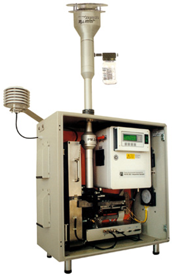

\[image courtesy of [Kirsten Koehler](https://www.jhsph.edu/faculty/directory/profile/2928/kirsten-koehler)\]

. . .

These monitors use a filtration system to specifically capture fine particulate matter.

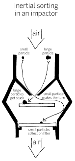

[\[source\]](https://publiclab.org/wiki/filter-pm){target="_blank"}

. . .

The weight of this particulate matter is manually measured daily or weekly.

For the EPA standard operating procedure for PM gravimetric analysis in 2008, we refer the reader to [here](https://www3.epa.gov/ttnamti1/files/ambient/pm25/spec/RTIGravMassSOPFINAL.pdf){target="_blank"}.

. . .

In our data set, the `value` column indicates the PM~2.5~ monitor average for 2008 in mass of fine particles/volume of air for 876 gravimetric monitors.

. . .

The units are micrograms of fine particulate matter (PM) that is less than 2.5 micrometers in diameter per cubic meter of air - mass concentration (ug/m^3^).

. . .

Recall the WHO exposure guideline is \< 10 ug/m^3^ on average annually for PM~2.5~.

## Data Import

All of our data was previously collected by a [researcher](http://www.biostat.jhsph.edu/~rpeng/) at the [Johns Hopkins School of Public Health](https://www.jhsph.edu/) who studies air pollution and climate change. (Roger now works at UT Austin)

. . .

We have one CSV file that contains both our single **outcome variable** and all of our **features** (or predictor variables). You can download this file using the `OCSdata` package:

```{r, eval=FALSE}
# install.packages("OCSdata")
OCSdata::raw_data("ocs-bp-air-pollution", outpath = getwd())
```

. . .

```{r}
pm <- read_csv("OCS_data/data/raw/pm25_data.csv")
```

. . .

## Get The Data

Read the data in so you can follow along now!

::: aside
Put a [green]{.sticky-green} sticky on the front of your computer when you've got the code running. Put a [pink]{.sticky-pink} if you want help/have a question.
:::

## PM 2.5 Data

-   876 monitors
-   40 columns
    -   `value` \| outcome variable

```{r}
pm |>
  glimpse()
```

. . .

There are 48 features with values for each of the 876 monitors (observations).

The data comes from the US [Environmental Protection Agency (EPA)](https://www.epa.gov/){target="_blank"}, the [National Aeronautics and Space Administration (NASA)](https://www.nasa.gov/){target="_blank"}, the US [Census](https://www.census.gov/about/what/census-at-a-glance.html){target="_blank"}, and the [National Center for Health Statistics (NCHS)](https://www.cdc.gov/nchs/about/index.htm){target="_blank"}.

## Features {.smaller}

| Variable                        | Details                                                                                                                                                                                                                                                                                                                                                                                                                                                                                        |
|--------------------------------|----------------------------------------|
| **id**                          | Monitor number <br> -- the county number is indicated before the decimal <br> -- the monitor number is indicated after the decimal <br> **Example**: 1073.0023 is Jefferson county (1073) and .0023 one of 8 monitors                                                                                                                                                                                                                                                                          |
| **fips**                        | Federal information processing standard number for the county where the monitor is located <br> -- 5 digit id code for counties (zero is often the first value and sometimes is not shown) <br> -- the first 2 numbers indicate the state <br> -- the last three numbers indicate the county <br> **Example**: Alabama's state code is 01 because it is first alphabetically <br> (note: Alaska and Hawaii are not included because they are not part of the contiguous US)                    |
| **Lat**                         | Latitude of the monitor in degrees                                                                                                                                                                                                                                                                                                                                                                                                                                                             |
| **Lon**                         | Longitude of the monitor in degrees                                                                                                                                                                                                                                                                                                                                                                                                                                                            |
| **state**                       | State where the monitor is located                                                                                                                                                                                                                                                                                                                                                                                                                                                             |
| **county**                      | County where the monitor is located                                                                                                                                                                                                                                                                                                                                                                                                                                                            |
| **city**                        | City where the monitor is located                                                                                                                                                                                                                                                                                                                                                                                                                                                              |
| **CMAQ**                        | Estimated values of air pollution from a computational model called [**Community Multiscale Air Quality (CMAQ)**](https://www.epa.gov/cmaq){target="_blank"} <br> -- A monitoring system that simulates the physics of the atmosphere using chemistry and weather data to predict the air pollution <br> -- ***Does not use any of the PM~2.5~ gravimetric monitoring data.*** (There is a version that does use the gravimetric monitoring data, but not this one!) <br> -- Data from the EPA |
| **zcta**                        | [Zip Code Tabulation Area](https://en.wikipedia.org/wiki/ZIP_Code_Tabulation_Area){target="_blank"} where the monitor is located <br> -- Postal Zip codes are converted into "generalized areal representations" that are non-overlapping <br> -- Data from the 2010 Census                                                                                                                                                                                                                    |
| **zcta_area**                   | Land area of the zip code area in meters squared <br> -- Data from the 2010 Census                                                                                                                                                                                                                                                                                                                                                                                                             |
| **zcta_pop**                    | Population in the zip code area <br> -- Data from the 2010 Census                                                                                                                                                                                                                                                                                                                                                                                                                              |
| **imp_a500**                    | Impervious surface measure <br> -- Within a circle with a radius of 500 meters around the monitor <br> -- Impervious surface are roads, concrete, parking lots, buildings <br> -- This is a measure of development                                                                                                                                                                                                                                                                             |
| **imp_a1000**                   | Impervious surface measure <br> -- Within a circle with a radius of 1000 meters around the monitor                                                                                                                                                                                                                                                                                                                                                                                             |
| **imp_a5000**                   | Impervious surface measure <br> -- Within a circle with a radius of 5000 meters around the monitor                                                                                                                                                                                                                                                                                                                                                                                             |
| **imp_a10000**                  | Impervious surface measure <br> -- Within a circle with a radius of 10000 meters around the monitor                                                                                                                                                                                                                                                                                                                                                                                            |
| **imp_a15000**                  | Impervious surface measure <br> -- Within a circle with a radius of 15000 meters around the monitor                                                                                                                                                                                                                                                                                                                                                                                            |
| **county_area**                 | Land area of the county of the monitor in meters squared                                                                                                                                                                                                                                                                                                                                                                                                                                       |
| **county_pop**                  | Population of the county of the monitor                                                                                                                                                                                                                                                                                                                                                                                                                                                        |
| **Log_dist_to_prisec**          | Log (Natural log) distance to a primary or secondary road from the monitor <br> -- Highway or major road                                                                                                                                                                                                                                                                                                                                                                                       |
| **log_pri_length_5000**         | Count of primary road length in meters in a circle with a radius of 5000 meters around the monitor (Natural log) <br> -- Highways only                                                                                                                                                                                                                                                                                                                                                         |
| **log_pri_length_10000**        | Count of primary road length in meters in a circle with a radius of 10000 meters around the monitor (Natural log) <br> -- Highways only                                                                                                                                                                                                                                                                                                                                                        |
| **log_pri_length_15000**        | Count of primary road length in meters in a circle with a radius of 15000 meters around the monitor (Natural log) <br> -- Highways only                                                                                                                                                                                                                                                                                                                                                        |
| **log_pri_length_25000**        | Count of primary road length in meters in a circle with a radius of 25000 meters around the monitor (Natural log) <br> -- Highways only                                                                                                                                                                                                                                                                                                                                                        |
| **log_prisec_length_500**       | Count of primary and secondary road length in meters in a circle with a radius of 500 meters around the monitor (Natural log) <br> -- Highway and secondary roads                                                                                                                                                                                                                                                                                                                              |
| **log_prisec_length_1000**      | Count of primary and secondary road length in meters in a circle with a radius of 1000 meters around the monitor (Natural log) <br> -- Highway and secondary roads                                                                                                                                                                                                                                                                                                                             |
| **log_prisec_length_5000**      | Count of primary and secondary road length in meters in a circle with a radius of 5000 meters around the monitor (Natural log) <br> -- Highway and secondary roads                                                                                                                                                                                                                                                                                                                             |
| **log_prisec_length_10000**     | Count of primary and secondary road length in meters in a circle with a radius of 10000 meters around the monitor (Natural log) <br> -- Highway and secondary roads                                                                                                                                                                                                                                                                                                                            |
| **log_prisec_length_15000**     | Count of primary and secondary road length in meters in a circle with a radius of 15000 meters around the monitor (Natural log) <br> -- Highway and secondary roads                                                                                                                                                                                                                                                                                                                            |
| **log_prisec_length_25000**     | Count of primary and secondary road length in meters in a circle with a radius of 25000 meters around the monitor (Natural log) <br> -- Highway and secondary roads                                                                                                                                                                                                                                                                                                                            |
| **log_nei_2008_pm25_sum_10000** | Tons of emissions from major sources data base (annual data) sum of all sources within a circle with a radius of 10000 meters of distance around the monitor (Natural log)                                                                                                                                                                                                                                                                                                                     |
| **log_nei_2008_pm25_sum_15000** | Tons of emissions from major sources data base (annual data) sum of all sources within a circle with a radius of 15000 meters of distance around the monitor (Natural log)                                                                                                                                                                                                                                                                                                                     |
| **log_nei_2008_pm25_sum_25000** | Tons of emissions from major sources data base (annual data) sum of all sources within a circle with a radius of 25000 meters of distance around the monitor (Natural log)                                                                                                                                                                                                                                                                                                                     |
| **log_nei_2008_pm10_sum_10000** | Tons of emissions from major sources data base (annual data) sum of all sources within a circle with a radius of 10000 meters of distance around the monitor (Natural log)                                                                                                                                                                                                                                                                                                                     |
| **log_nei_2008_pm10_sum_15000** | Tons of emissions from major sources data base (annual data) sum of all sources within a circle with a radius of 15000 meters of distance around the monitor (Natural log)                                                                                                                                                                                                                                                                                                                     |
| **log_nei_2008_pm10_sum_25000** | Tons of emissions from major sources data base (annual data) sum of all sources within a circle with a radius of 25000 meters of distance around the monitor (Natural log)                                                                                                                                                                                                                                                                                                                     |
| **popdens_county**              | Population density (number of people per kilometer squared area of the county)                                                                                                                                                                                                                                                                                                                                                                                                                 |
| **popdens_zcta**                | Population density (number of people per kilometer squared area of zcta)                                                                                                                                                                                                                                                                                                                                                                                                                       |
| **nohs**                        | Percentage of people in zcta area where the monitor is that **do not have a high school degree** <br> -- Data from the Census                                                                                                                                                                                                                                                                                                                                                                  |
| **somehs**                      | Percentage of people in zcta area where the monitor whose highest formal educational attainment was **some high school education** <br> -- Data from the Census                                                                                                                                                                                                                                                                                                                                |
| **hs**                          | Percentage of people in zcta area where the monitor whose highest formal educational attainment was completing a **high school degree** <br> -- Data from the Census                                                                                                                                                                                                                                                                                                                           |
| **somecollege**                 | Percentage of people in zcta area where the monitor whose highest formal educational attainment was completing **some college education** <br> -- Data from the Census                                                                                                                                                                                                                                                                                                                         |
| **associate**                   | Percentage of people in zcta area where the monitor whose highest formal educational attainment was completing an **associate degree** <br> -- Data from the Census                                                                                                                                                                                                                                                                                                                            |
| **bachelor**                    | Percentage of people in zcta area where the monitor whose highest formal educational attainment was a **bachelor's degree** <br> -- Data from the Census                                                                                                                                                                                                                                                                                                                                       |
| **grad**                        | Percentage of people in zcta area where the monitor whose highest formal educational attainment was a **graduate degree** <br> -- Data from the Census                                                                                                                                                                                                                                                                                                                                         |
| **pov**                         | Percentage of people in zcta area where the monitor is that lived in [**poverty**](https://aspe.hhs.gov/2008-hhs-poverty-guidelines) in 2008 - or would it have been 2007 guidelines??https://aspe.hhs.gov/2007-hhs-poverty-guidelines <br> -- Data from the Census                                                                                                                                                                                                                            |
| **hs_orless**                   | Percentage of people in zcta area where the monitor whose highest formal educational attainment was a **high school degree or less** (sum of nohs, somehs, and hs)                                                                                                                                                                                                                                                                                                                             |
| **urc2013**                     | [2013 Urban-rural classification](https://www.cdc.gov/nchs/data/series/sr_02/sr02_166.pdf){target="_blank"} of the county where the monitor is located <br> -- 6 category variable - 1 is totally urban 6 is completely rural <br> -- Data from the [National Center for Health Statistics](https://www.cdc.gov/nchs/index.htm){target="_blank"}                                                                                                                                               |
| **urc2006**                     | [2006 Urban-rural classification](https://www.cdc.gov/nchs/data/series/sr_02/sr02_154.pdf){target="_blank"} of the county where the monitor is located <br> -- 6 category variable - 1 is totally urban 6 is completely rural <br> -- Data from the [National Center for Health Statistics](https://www.cdc.gov/nchs/index.htm){target="_blank"}                                                                                                                                               |
| **aod**                         | Aerosol Optical Depth measurement from a NASA satellite <br> -- based on the diffraction of a laser <br> -- used as a proxy of particulate pollution <br> -- unit-less - higher value indicates more pollution <br> -- Data from NASA                                                                                                                                                                                                                                                          |

. . .

Many of these features have to do with the circular area around the monitor called the "buffer". These are illustrated in the following figure:

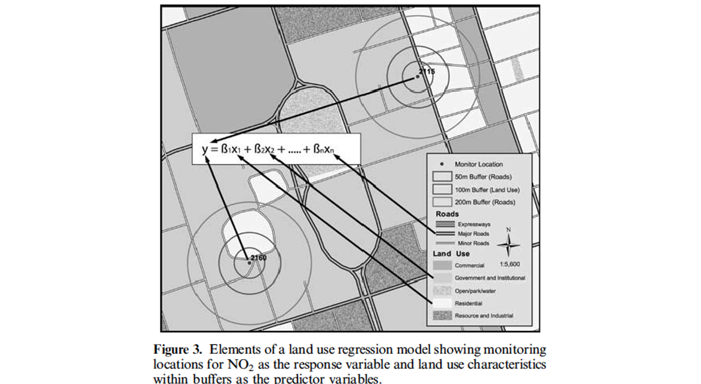

[\[source\]](https://www.ncbi.nlm.nih.gov/pubmed/15292906){target="_blank"}

## Your Turn

Scroll through the data, consider 1) if these data are in tidy format and 2) which variables you think may be most helpful in building a model to predict annual air pollution.

::: aside
Put a [green]{.sticky-green} sticky on the front of your computer when you're done. Put a [pink]{.sticky-pink} if you want help/have a question.
:::
