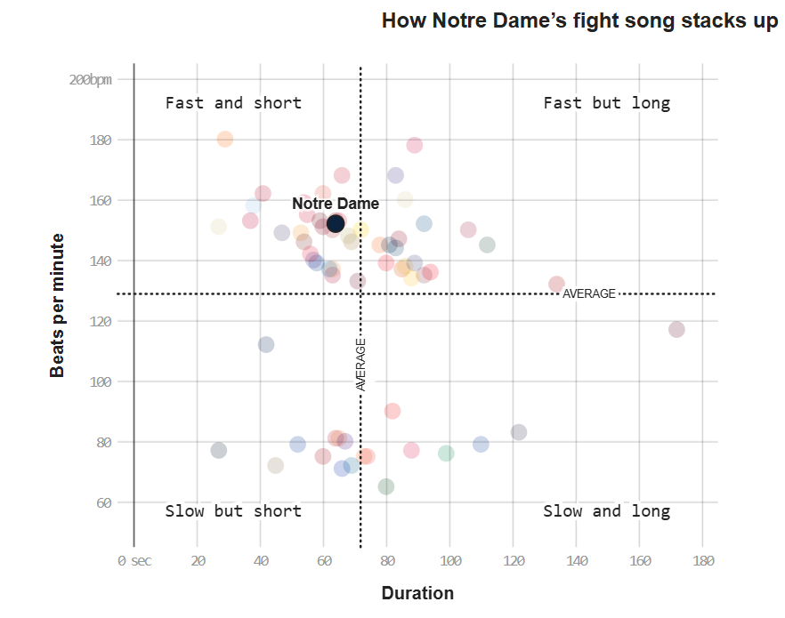
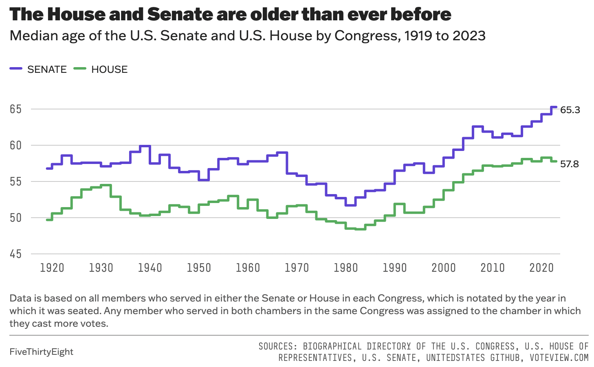
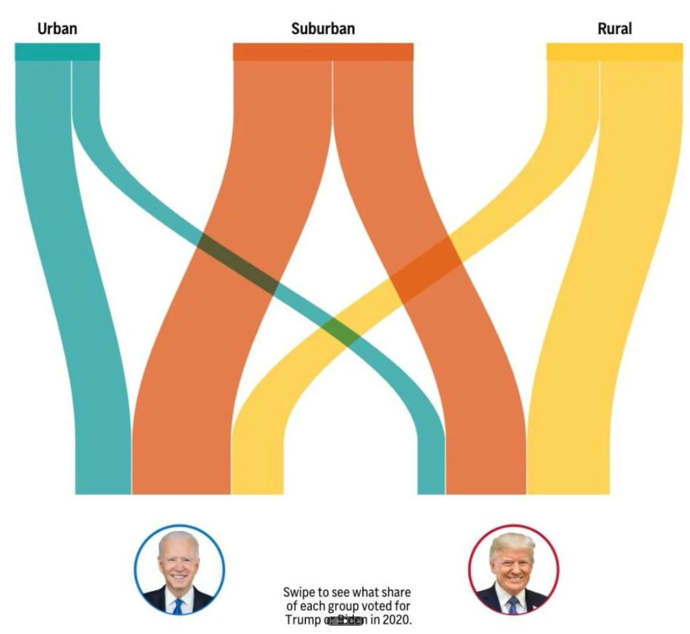
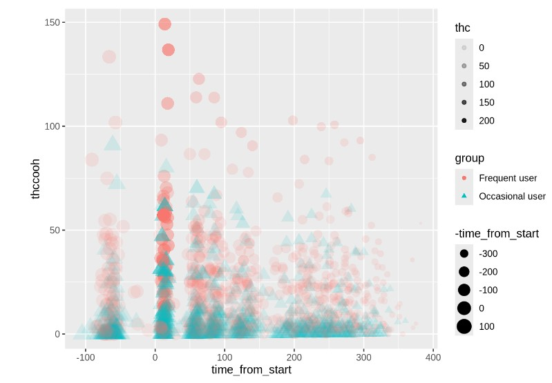
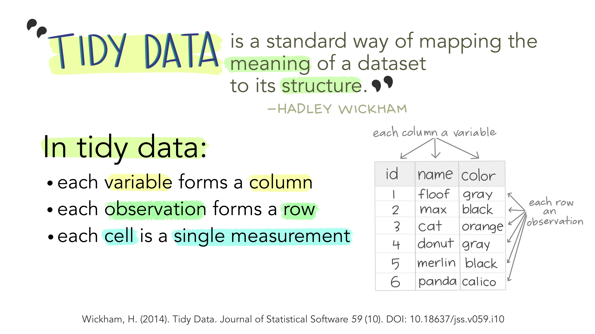
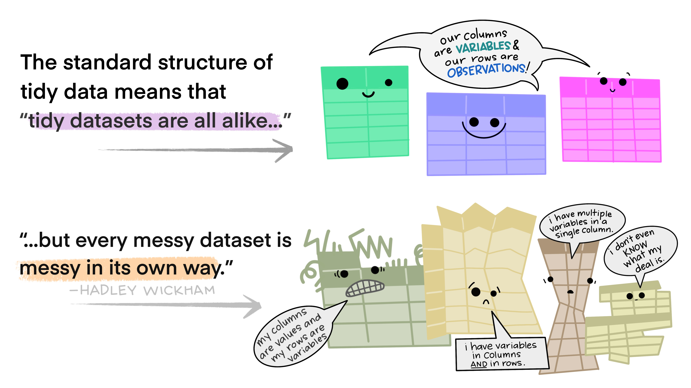
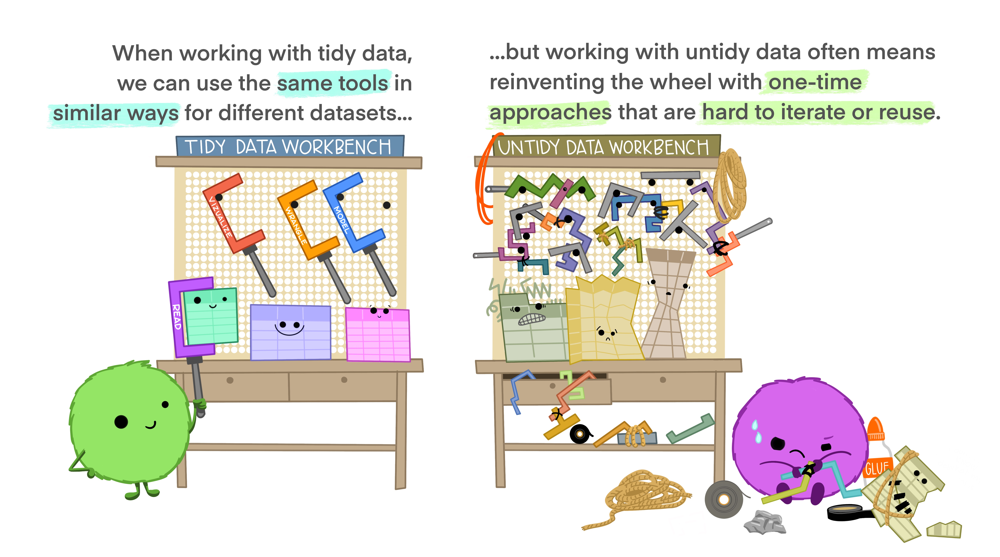
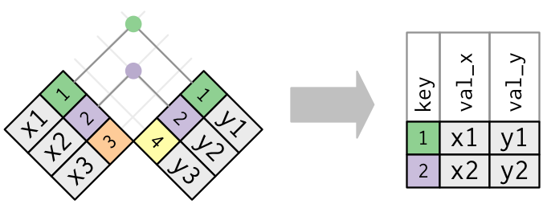

```{r packages, echo = FALSE, message=FALSE, warning=FALSE}
library(tidyverse)
library(emo)

knitr::opts_chunk$set(dpi = 300, echo=TRUE, warning=FALSE, message=FALSE) 
```

# CS02: Predicting Air Pollution (EDA) {background-color="#92A86A"}

## Q&A {.scrollable .smaller}

<!-- Copy this box once per question. Put the question after "Q:" in the title and your answer in the body. -->

::: {.callout-note collapse="true" title="Q: "}
A:
:::

## Course Announcements

**Due Dates**:

-   ⌨️ **Lab 04** due Fri 10/30 (11:59 PM)
-   💻 **CS01** (report in repo + general communication on Canvas) & 🔘 CS01 team eval survey due Fri 10/30 (11:59 PM)
-   🔘 **Mid-course survey** due Fri 10/30 (11:59 PM)
-   📄 **Final Project Proposal** due Wed 11/4 (11:59 PM)
-   ⌨️ **Lab 05** due Fri 11/6 (11:59 PM)
-   🔘 Lecture Participation survey "due" after class

```{=html}
<!-- FA24 announcements, kept for reference:
-   `r emo::ji("science")` **Lab 05** due tonight
-   🔘 [**CS01 Team Eval**](https://docs.google.com/forms/d/e/1FAIpQLSdmiYgXilgqMu5ZWBW8grpCLXeyhzrvwhsCbxYBp31qQMrRPg/viewform) survey due tonight
-   📄 [**Final Project Proposal**](https://docs.google.com/forms/d/e/1FAIpQLSfXBztrZuK0CeB8p3YZWr6M37oe16DGazuow7_g9Ulr6AiyXg/viewform?usp=sf_link) due Tuesday
-   `r emo::ji('clipboard')` Lecture Participation survey "due" after class

Note: Get the data data in RStudio for today if you haven't already (and `install.packages` `"OCSdata"`, `"skimr"`, and `"GGally"`.
-->
```
```{r}
# install.packages("OCSdata")
# OCSdata::raw_data("ocs-bp-air-pollution", outpath = getwd())
# in your CS02 repo, the file is at "data/pm25_data.csv"
pm <- read_csv("OCS_data/data/raw/pm25_data.csv") |>
  # these are ID codes, not measurements
  mutate(across(c(id, fips, zcta), as.factor))
```

## Topic Brainstorming

Let's brainstorm some topics together...

# HW02 (revisited) · replace with FA26 examples {background-color="#92A86A"}

## Part I: Imitation

## Fight Songs

::: panel-tabset
### Original



### Plot (Sailor)

```{r ref.label="C", echo = FALSE, out.width="100%"}
```

### Code (Sailor)

```{r C, fig.show = "hide"}
fight <- read_csv('data/fight-songs.csv', show_col_types = FALSE)
 
# Calculate avg_duration and avg_bpm across fight songs for classifying
avg_duration <- mean(fight$sec_duration, na.rm = TRUE)
avg_bpm <- mean(fight$bpm, na.rm = TRUE)

# Begin ggplot
ggplot(fight, aes(x = sec_duration, y = bpm)) +
  
  # Making sure Notre Dame is colored and referenced differently 
  geom_point(aes(color = ifelse(school == "Notre Dame", "Notre Dame", factor(school))), size = 5, alpha = 0.5) +
  scale_color_hue() +
  geom_vline(xintercept = avg_duration, linetype = "dotted", color = "black", size = 0.7) +
  geom_hline(yintercept = avg_bpm, linetype = "dotted", color = "black", size = 0.7) +
   annotate("text", x = avg_duration + 5, y = 100, label = "AVERAGE", angle = 90, vjust = -0.5, size = 3.5)  +
  # Adding in my labels for quadrants + AVERAGE
  annotate("text", x = 0, y = avg_bpm + 5, label = "AVERAGE", hjust = -0.5, size = 3.5) +
  annotate("text", x = 30, y = 190, label = "Fast and short", size = 4) +
  annotate("text", x = 130, y = 190, label = "Fast but long", size = 4) +
  annotate("text", x = 30, y = 60, label = "Slow but short", size = 4) +
  annotate("text", x = 130, y = 60, label = "Slow and long", size = 4) +
  geom_point(aes(x = 60, y = 150), color = "black", size = 5) +
  annotate("text", x = 60, y = 150, label = "Notre Dame", vjust = -1.5, fontface = "bold") +
  labs(x = "Duration", y = "Beats per minute") +
  
  # Scale my axis to adjust to match original 
  
  scale_x_continuous(breaks = seq(0, 180, by = 20)) +
  scale_y_continuous(breaks = seq(40, 200, by = 20), limits = c(40, 200)) +
  coord_fixed(ratio = 0.8) +  
  theme_minimal() +
  # Theme adjusting 
  
  theme(
    plot.margin = margin(t = 10, r = 10, b = 10, l = 20),
    legend.position = "none",
    panel.grid.minor = element_line(color = "grey90", linetype = "solid"),
    panel.grid.major = element_line(color = "grey80", linetype = "solid"),
    panel.border = element_rect(color = "black", fill = NA))
```

### Plot (v2)

```{r ref.label="D", echo = FALSE, out.width="100%"}
```

### Code (v2)

```{r D, fig.show = "hide"}
fight_songs_data <- fight
mean_bpm <- mean(fight_songs_data$bpm, na.rm = TRUE)
mean_duration <- mean(fight_songs_data$sec_duration, na.rm = TRUE)

ggplot(fight_songs_data, aes(x = sec_duration, y = bpm)) +
    geom_point(aes(color = school), alpha = 0.2, size = 5) +
    geom_vline(xintercept = mean_duration, linetype = "dotted", color = "black") +
    geom_hline(yintercept = mean_bpm, linetype = "dotted", color = "black") +
    geom_point(data = filter(fight_songs_data, school == "Stanford"), 
               aes(x = sec_duration, y = bpm), 
               color = "red", size = 5, shape = 21, fill = "red") +
    geom_text(data = filter(fight_songs_data, school == "Stanford"), 
              aes(x = sec_duration, y = bpm, label = "Stanford", fontface = "bold", family = "Arial"), 
              vjust = -1, color = "black", size = 4) +
    labs(
        title = "How Stanford's Fight Song stacks up",
        x = "Duration",
        y = "Beats per minute"
    ) +
    scale_y_continuous(breaks = seq(60, 200, by = 20),
                       labels = c("60", "80", "100", "120", "140", "160", "180", "200bpm"),
                       limits = c(60, 200)) +
    scale_x_continuous(breaks = seq(0, 180, by = 20), 
                       labels = c("0 sec", "20", "40", "60", "80", "100", "120", "140", "160", "180")) +
    annotate("text", x = 10, y = 190, label = "Fast and short", size = 4, hjust = 0, family = "Courier") +
    annotate("text", x = 10, y = 70, label = "Slow but short", size = 4, hjust = 0, family = "Courier") +
    annotate("text", x = 140, y = 190, label = "Fast but long", size = 4, hjust = 1, family = "Courier") +
    annotate("text", x = 140, y = 70, label = "Slow and long", size = 4, hjust = 1, family = "Courier") +
    annotate("text", x = max(fight_songs_data$sec_duration) - 20, y = mean_bpm, 
             label = "AVERAGE", vjust = 0.5, hjust = -0.1, color = "black", size = 3, family = "Arial") +
    theme_minimal() +
    theme(
        legend.position = "none",
        plot.title = element_text(hjust = 0.5, face = "bold", family = "Arial"),
        panel.grid.major = element_line(size = 0.5),
        panel.grid.minor = element_blank()
    )
```
:::

## Hate Crimes (Adam)

::: panel-tabset
### Original


### Plot

```{r ref.label="Adam", echo = FALSE, out.width="100%"}
```

### Code

```{r Adam, fig.show = "hide"}
# Load data
url <- "https://raw.githubusercontent.com/fivethirtyeight/data/master/hate-crimes/hate_crimes.csv"
hate_crimes <- read_csv(url)

states_map <- map_data("state")
hate_crimes <- hate_crimes |>
  mutate(state = tolower(state)) 

map_data <- states_map |>
  left_join(hate_crimes, by = c("region" = "state"))


#Graph Numero Uno

ggplot(map_data, aes(x = long, y = lat, group = group, fill = avg_hatecrimes_per_100k_fbi)) +
  geom_polygon(color = "white") +
  scale_fill_gradient(low = "#ffe4d0", high = "#ba3900", na.value = "gray", name = "Hate Crimes\nper 100k") +
  labs(title = "PRE-ELECTION HATE CRIME RATES POST-ELECTION",
       subtitle = "Average annual hate crimes per 100,000 residents, 2010-15") +
  theme_minimal() +
  theme(    axis.text.x = element_blank(),
    plot.title = element_text(face = 'bold'),
    axis.ticks.x = element_blank(),
    axis.text.y = element_blank(),
    axis.ticks.y = element_blank(),
    axis.title.x = element_blank(),
    axis.title.y = element_blank(),
    panel.grid = element_blank(),
    legend.position = "top", 
    legend.title = element_text(size=6),
    
  ) +
  coord_fixed(1.3) #Unstretch

#Second Graph
ggplot(map_data, aes(x = long, y = lat, group = group, fill = hate_crimes_per_100k_splc)) +
  geom_polygon(color = "white") +
  scale_fill_gradient(low = "#b0e2c8", high = "#006646", na.value = "gray", name = "Hate Crimes\nper 100k") +
  labs(title = "POST-ELECTION HATE CRIME RATES POST-ELECTION",
       subtitle = "Average annual hate crimes per 100,000 residents, 2010-15") +
  theme_minimal() +
  theme(    axis.text.x = element_blank(),
    plot.title = element_text(face = 'bold'),
    axis.ticks.x = element_blank(),
    axis.text.y = element_blank(),
    axis.ticks.y = element_blank(),
    axis.title.x = element_blank(),
    axis.title.y = element_blank(),
    panel.grid = element_blank(),
    legend.position = "top", 
    legend.title = element_text(size=6),
    
  ) +
  coord_fixed(1.3) #Unstretch
```
:::

## Congress Age

::: panel-tabset
### Original



### Plot

```{r ref.label="Congress", echo = FALSE, out.width="100%"}
```

### Code

```{r Congress, fig.show = "hide"}
congress_data = read_csv("data/data_aging_congress.csv")

congress_data <- congress_data |>
  mutate(year = as.numeric(format(start_date, "%Y")))  #Extracted year from start_date

#Grouping Congress by session to calculate median age
congress_median_age <- congress_data |>
  group_by(congress, year, chamber) |>
  summarise(median_age = median(age_years, na.rm = TRUE)) |>
  ungroup()

ggplot(congress_median_age, aes(x = year, y = median_age, color = chamber)) +
  geom_step(linewidth = 1) +  
  #Senate
  geom_text(data = congress_median_age |> 
              filter(chamber == "Senate", year == 2023),  
            aes(label = "65.3"), 
            hjust = -0.2, vjust = +0.3, size = 3, color = "black", show.legend = FALSE) + 
  #House
  geom_text(data = congress_median_age |> 
              filter(chamber == "House", year == 2023), 
            aes(label = "57.8"), 
            hjust = -0.2, vjust = -0.5, size = 3, color = "black", show.legend = FALSE) +
  #Titles
  labs(title = "Median Age of the U.S. Senate and House by Congress, 1919 to 2023",
       subtitle = "The House and Senate are older than ever before",
       x = "Year",
       y = "Median Age",
       color = "Chamber") +  
    scale_color_manual(values = c("Senate" = "#5b41d1", "House" = "#55aa5c"))+
  #Scaling both axis
  scale_x_continuous(limits = c(min(congress_median_age$year), max(congress_median_age$year)), breaks = seq(1920, 2020, by =  10)) +
  scale_y_continuous(limits = c(45, NA)) +
  theme_minimal() +  
  theme(plot.title = element_text(face = "bold", size = 14),  
        plot.subtitle = element_text(size = 10),
        axis.title = element_text(size = 12),
        legend.position = "top",
        aspect.ratio = 1/4,
        panel.grid.major.x = element_blank(),
        panel.grid.minor.x = element_blank(),
        panel.grid.minor.y = element_blank())
```
:::

## Part II: Sad Plot

## Votes

::: panel-tabset
### Original



### Plot

```{r ref.label="sad", echo = FALSE, out.width="100%"}
```

### Code

```{r sad, fig.show = "hide"}
# estimate data
d <- data.frame(
  area = rep(c('Rural', 'Suburban', 'Urban'), each = 2),
  voted = rep(c('Biden', 'Trump'), times = 3),
  percentages = c(35, 65, 55, 45, 70, 30)
)

# plot

ggplot(d, aes(x = area, y = percentages, fill = voted)) +
  geom_bar(stat = "identity", position = "dodge") +
  labs(
    title = "Votes for Trump and Biden in 2020 Elecxtion Based on Location",
    x = "Location",
    y = "Percentage of Votes",
    fill = "Candidate"  # Legend title
  ) +
  scale_y_continuous(breaks = seq(0, 100, by = 10), limits = c(0, 80)) +
  theme_minimal() +
  scale_fill_manual(values = c("#0033A0", "#C8102E"))  # Custom colors for groups
```
:::

## CS01 Data (Sandy)

::: panel-tabset
### Original



### Plot

```{r ref.label="cs01", echo = FALSE, out.width="100%"}
```

### Code

```{r cs01, fig.show = "hide"}
WB <- read_csv("data/Blood.csv")

WB <- WB |> 
  mutate(Treatment = fct_recode(Treatment, 
                                "5.9% THC (low dose)" = "5.90%",
                                "13.4% THC (high dose)" = "13.40%"),
         Treatment = fct_relevel(Treatment, "Placebo", "5.9% THC (low dose)"),
         Group = fct_recode(Group,
                            "Frequent User" = "Frequent user",
                            "Occasional User" = "Occasional user")) |> 
  janitor::clean_names() |>
  rename(thcoh = x11_oh_thc,
         thccooh = thc_cooh,
         thccooh_gluc = thc_cooh_gluc,
         thcv = thc_v) |>
  mutate(timepoint = case_when(time_from_start < 0 ~ "pre-smoking",
                               time_from_start > 0 & time_from_start <= 30 ~ "0-30 min",
                               time_from_start > 30 & time_from_start <= 70 ~ "31-70 min",
                               time_from_start > 70 & time_from_start <= 100 ~ "71-100 min",
                               time_from_start > 100 & time_from_start <= 180 ~ "101-180 min",
                               time_from_start > 180 & time_from_start <= 210 ~ "181-210 min",
                               time_from_start > 210 & time_from_start <= 240 ~ "211-240 min",
                               time_from_start > 240 & time_from_start <= 270 ~ "241-270 min",
                               time_from_start > 270 & time_from_start <= 300 ~ "271-300 min",
                               time_from_start > 300 ~ "301+ min"))

WB |>
  ggplot(mapping = aes(x = time_from_start,
                       y = thccooh,
                       color = group)) +
  geom_point(size = 3) +
  labs(x = "Time After Smoking (Minutes)", y = "THCCOOH", 
       title = "Change in THCCOOH Levels After Smoking",
       subtitle = "Levels measured over time for frequent and occasional users",
       color = "Group") +
  theme(plot.title = element_text(size = 20, hjust = 0, vjust = 2),
        plot.subtitle = element_text(size = 16, hjust = 0, vjust = 1)) +
  scale_color_manual(values = c("Frequent User" = "#fc8d59",
                                "Occasional User" = "#91bfdb")) +
  theme_minimal()
```
:::

# Data Wrangling: `tidyr` {background-color="#92A86A"}

-   pivots (`tidyr`)
-   joins (`dplyr`)

## Reminder: Tidy Data



. . .



. . .



## Pivoting

Storing the same data in a different format

. . .

### long vs. wide

-   **wide** data contains values that do not repeat in the first column. (analysis; storage)
-   **long** format contains values that do repeat in the first column. (plotting)

## pivots

-   `pivot_longer` \| take wide data and make it long
-   `pivot_wider` \| take long data and make it wide

## Joins

Combining data across different datasets, using common information (often: IDs)

. . .

**Mutating Joins**

add new variables to a data frame from matching observations in another

. . .

-   **`left_join`**: keeps all rows in first df; adds all matching information from second df; adds NAs for any observations missing information
-   **`right_join`**: keeps all observations in second df
-   **`full_join`**: keeps all observations in either df

. . .


. . .

**`inner_join`**: takes only rows in *both* dfs



## Binding dataframes

-   `bind_rows()` - stack different dataframes on top of one another, combining information where column names are the same \<- *what I used to combine the three datasets after wrangling*
-   `bind_cols()` - stack dataframes next to one another; will assume rows match up \<- use with caution

# Question {background-color="#92A86A"}

> With what accuracy can we predict US annual average air pollution concentrations?

# Wrangling {background-color="#92A86A"}

## Viewing the data

Take a look...

. . .

[`r emo::ji("question")` Given the dataset we're working with, what wrangling should we consider doing here?"]{style="background-color: #ADD8E6"}

# EDA {background-color="#92A86A"}

Getting to "know" the data

## `skimr` {.smaller}

`skimr` \| A helpful way to get an overall sense of a dataset

```{r}
# install.packages("skimr")
skimr::skim(pm)
```

. . .

[`r emo::ji("question")` What's something you've learned about the data from the <code>skimr</code> output?]{style="background-color: #ADD8E6"}

. . .

Things to note:

::: incremental
-   data are summarized by variable type
-   `empty`/`n_missing` gives you a sense of how much data are missing for each variable
-   `n_unique` for `state` indicates that we have data for 49 states
-   many different distributions for continuous data, but many show bimodal distribution
-   large range of possible values for many variables (i.e. population)
:::

. . .

-   Consider variable type - need more factors?
-   Understand why ID is not uniformally distributed; figure out which are overrepresented; decide what to do
-   log or other transformations necessary? decide during EDA

## Why 49 "states"?

```{r}
pm |> 
  distinct(state) 
```

-   DC is included
-   Alaska and Hawaii are not

## Number of monitors per city?

```{r}
pm |> filter(city == "San Diego")
```

. . .

```{r}
pm |> filter(city == "Baltimore")
```

. . .

San Diego has 2, while Baltimore has 5, despite having very similar population densities (`popdens_county`)...and San Diego having a much larger population (`county_pop`) and land area (`county_area`).

## Day 2 · Mon 11/2 {background-color="#92A86A"}

Picking up with relationships among features.

## Feature Correlation

Why do we care if variables in our dataset are correlated?

-   we don’t want to include redundant variables
-   can add unnecessary noise to our algorithm causing a reduction in prediction accuracy
-   can cause our algorithm to be slower
-   can also make it difficult to interpret what variables are actually predictive

. . .

Taking a look at our numeric variables...

```{r}
PM_cor <- cor(pm |> select(where(is.numeric)))
corrplot::corrplot(PM_cor, tl.cex = 0.5)
```

-   deep blue \| strongly, positively correlated
-   deep red \| strongly, negatively correlated

. . .

If we don't care about direction, but only strength...*and* using [hierarchical clustering](https://en.wikipedia.org/wiki/Hierarchical_clustering):

```{r}
corrplot::corrplot(abs(PM_cor), order = "hclust", tl.cex = 0.5, col.lim = c(0, 1))

```

. . .

Observations:

-   development variables (`imp`), road density (`pri`), and the emission (`nei`) variables all seem to be correlated with their group
-   none of the predictors are correlated with `value` (our outcome)

## Development (`imp`)

```{r}
select(pm, contains("imp")) |>
  GGally::ggpairs()
```

## Emmissoins (`nei`)

```{r}
select(pm, contains("nei")) |>
  GGally::ggpairs()
```

. . .

## Road Density (`pri`)

```{r}
select(pm, contains("pri")) |>
  GGally::ggcorr(hjust = .85, size = 3,
       layout.exp=2, label = TRUE)
```

Warning: colors are reversed from above. If included in final report, you'd want consistency.

## Are the categories correlated with one another?

```{r}
pm |>
select(log_nei_2008_pm25_sum_10000, popdens_county, 
       log_pri_length_10000, imp_a10000, county_pop) |>
  GGally::ggpairs()
```

. . .

Reminder:

-   **log_nei_2008_pm25_sum_10000** \| Tons of emissions from major sources data base (annual data) sum of all sources within a circle with a radius of 10000 meters of distance around the monitor (Natural log)\
-   **popdens_county** \| Population density (number of people per kilometer squared area of the county)
-   **log_pri_length_10000** \| Count of primary road length in meters in a circle with a radius of 10000 meters around the monitor (Natural log) <br> -- Highways only\
-   **imp_a10000** \| Impervious surface measure <br> -- Within a circle with a radius of 10000 meters around the monitor\
-   **county_pop** \| Population of the county of the monitor

## Log-transforming right-skewed data

```{r}
pm |>
  mutate(log_popdens_county=log(popdens_county),
         log_pop_county = log(county_pop)) |>
  select(log_nei_2008_pm25_sum_10000, log_popdens_county, 
       log_pri_length_10000, imp_a10000, log_pop_county) |>
  GGally::ggpairs()
```

## Your Turn

[`r emo::ji("muscle")` Try to learn at least three things about the data that we haven't yet discussed now on your own.]{style="background-color: #ADD8E6"}

Add your EDA to a Padlet <https://padlet.com/shannon0ellis/cs02_eda>

::: aside
Put a [green]{.sticky-green} sticky on the front of your computer when you're done. Put a [pink]{.sticky-pink} if you want help/have a question.
:::
