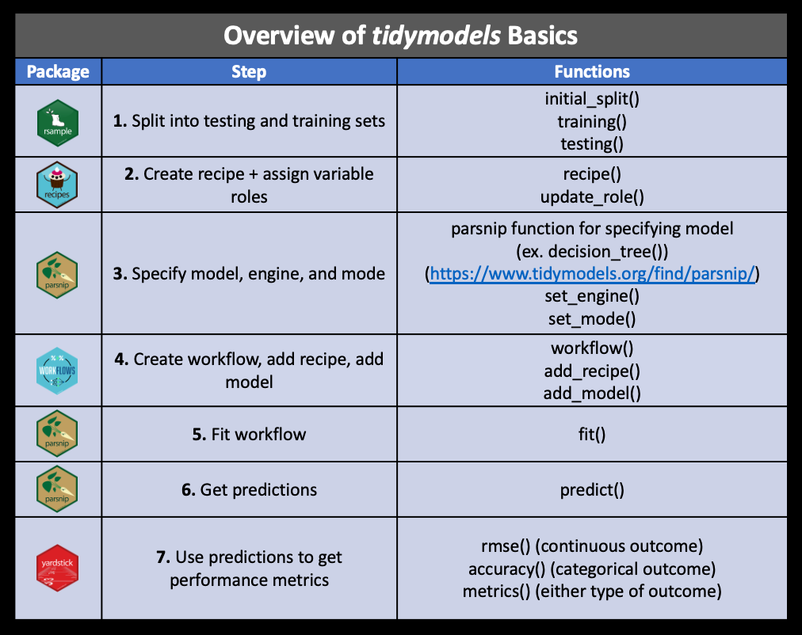
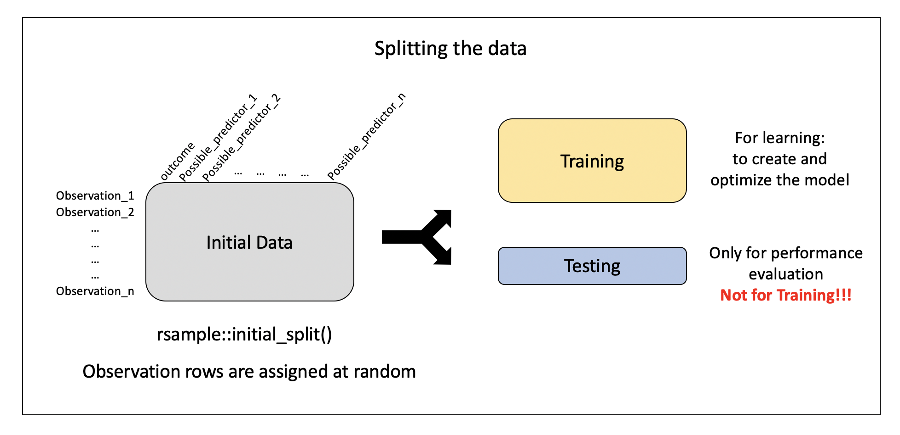
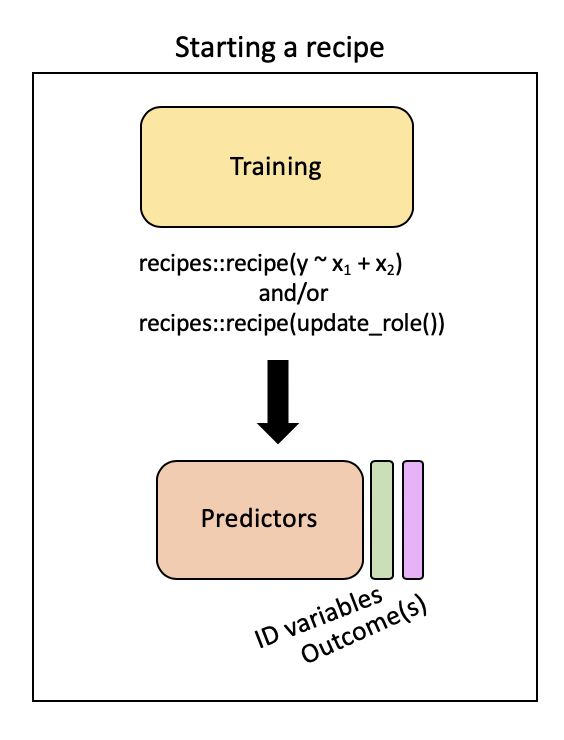
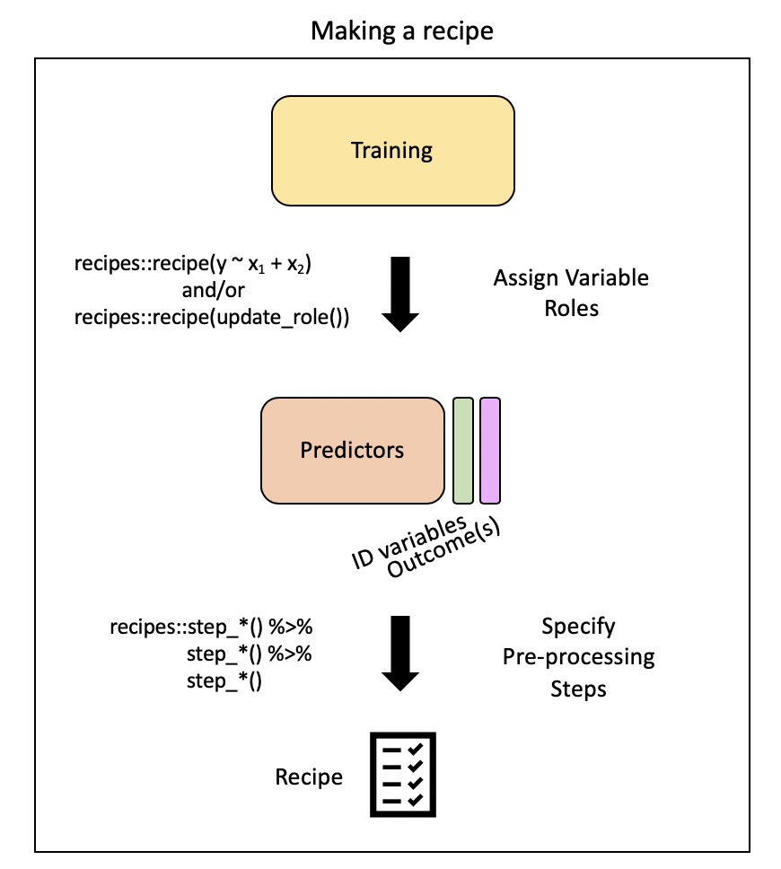
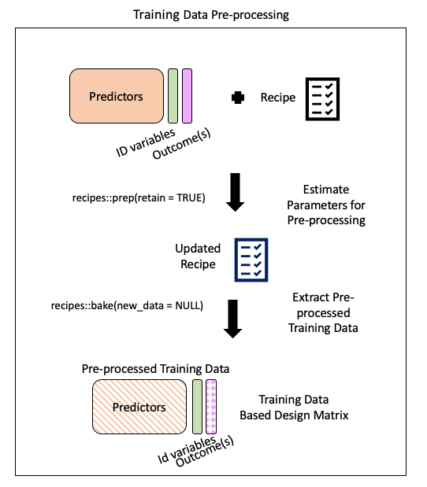
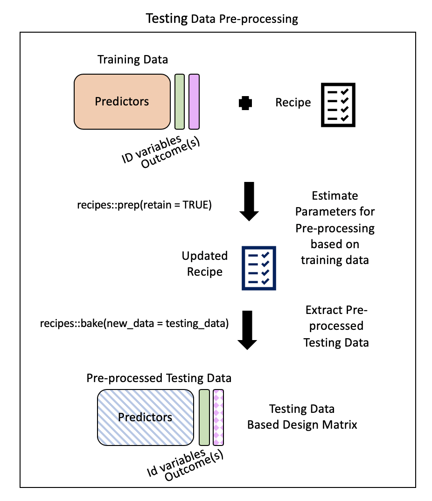
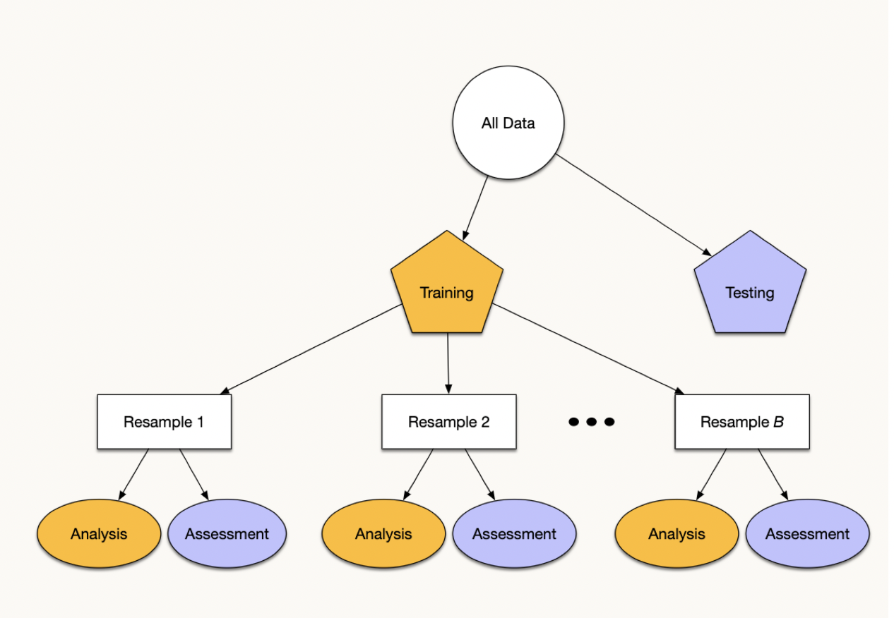
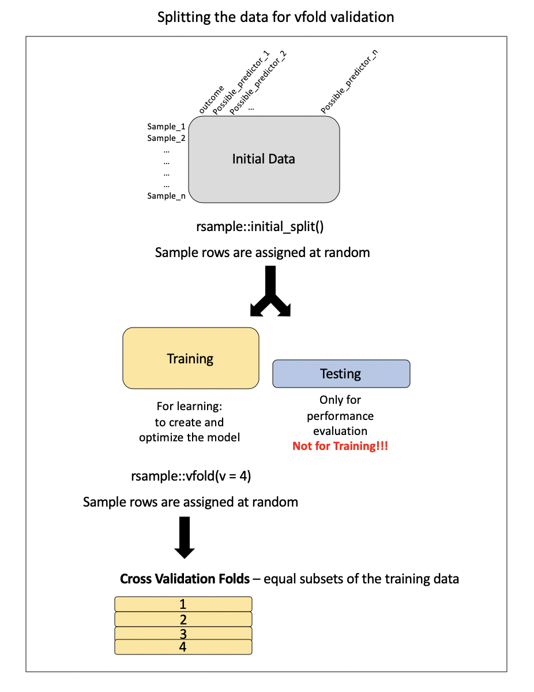
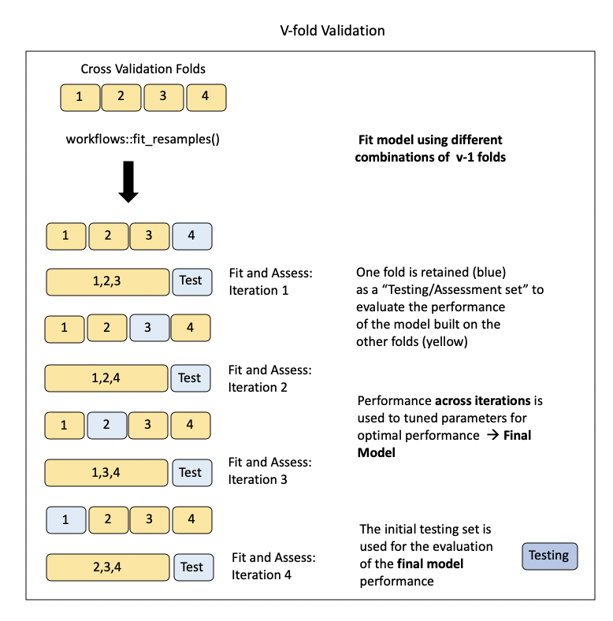

```{r packages, echo = FALSE, warning=FALSE, message=FALSE}
library(tidyverse)
library(tidymodels)
library(emo)

knitr::opts_chunk$set(dpi = 300, echo=TRUE, warning=FALSE) 
# keep printed tibbles short (good for slides)
options(pillar.print_max = 8, pillar.print_min = 6, width = 70)
```

# CS02: Predicting Air Pollution (Analysis) {background-color="#92A86A"}

## Q&A {.scrollable .smaller}


::: {.callout-note collapse="true" title="Q: How do multiple interaction effects work (3-4 variables interacting with each other)?"}
A: Consider this (maybe-too-familiar-at-week-7-in-the-quarter) but ultimately made-up example: predicting exam score from hours studied, hours of sleep, and cups of coffee.

There are two interactions to fit:

- studying × sleep: studying pays off more when you're well rested. But....an extra hour of studying on 4 hours of sleep doesn't help as much as the same hour on 8.
- coffee × sleep: coffee helps more when you're short on sleep. If you're already rested, it does less.

So the model would be:

score = β₀ + β₁*study + β₂*sleep + β₃*coffee + β₄*(study × sleep) + β₅*(coffee × sleep)

With some made-up numbers:

Say β₀ = 40, β₁ = 3, β₂ = 2, β₃ = 4, β₄ = 0.5, β₅ = −0.5.

Slope of studying = 3 + 0.5·sleep:

- On 4 hrs of sleep: each study hour is worth 5 points
- On 8 hrs: each study hour is worth 7 points

Slope of coffee = 4 − 0.5·sleep:

- On 4 hrs of sleep: each cup is worth 2 points
- On 8 hrs: each cup is worth 0 points

Slope of sleep = 2 + 0.5·study − 0.5·coffee <- sleep depends on two variables at once *b/c it's in both interaction terms*)

Note: the above is NOT a three-way interaction. It's two two-way interactions. A three-way term (study × sleep × coffee) would mean something like "the study–sleep synergy itself changes with coffee." Even that barely makes sense as I put it in the notes. In other words, three way interaction terms are hard to interpret and are therefore infrequently used.

I added this as a third tab on the [MLR explainer](https://claude.ai/artifact/GK8B1bwqZDFR682GGVBDoW#lecture-coding)
:::

::: {.callout-note collapse="true" title="Q: Can we see some prior final projects?"}
I haven't asked students to share their work here (although I always intend to..) so sharing a few questions for now:

  - With what accuracy can we predict the money laundering risk score of a black money transaction?
  - What is the relationship between a neighborhood's walkability and its crime rate?
  - Does Twitter usage affect professional tennis player performances, and can we determine a cutoff?
  - What are the key predictors of gun-related deaths across different regions in the U.S.?
  - How do Statcast metrics influence the home run performance of San Diego Padres players? Can a predictive model based on these metrics accurately identify top-performing players and explain discrepancies between expected and actual home runs?
:::


## Course Announcements {.scrollable .smaller}

**Due Dates**:

- **Lab 07** due today 11/13 (11:59 PM)
- 🔘 Lecture Participation survey "due" after class

Notes: 

- MLR w/ interaction [artifact](https://claude.ai/artifact/GK8B1bwqZDFR682GGVBDoW#lecture-coding)
- **CS01** scores/feedback posted (Feedback as issue on repo)
- *Next Sun*: CS02 + Final Project Rough Draft
  - Repos created
  - Class next Fri will be time to work on CS02


## Agenda {.scrollable .smaller}

**Day 1 · Fri 11/13**

1.  Split the data into training and testing sets
2.  Pre-process with a `recipe()`: roles, `step_*()`, `prep()`, `bake()`
3.  Make sure the recipe will work on new data
4.  Fit and assess a linear regression (`parsnip` + `workflow()`)

**Day 2 · Mon 11/16**

5.  Cross-validation
6.  Random forest + tuning
7.  Final evaluation on the test set: is that good? For whom?
8.  Mapping our results
9.  What this means for your case study

# Question {background-color="#92A86A"}

> With what accuracy can we predict US annual average air pollution concentrations?

# Analysis {background-color="#92A86A"}

## Building our `tidymodels` knowledge:



## The Data

```{r, message=FALSE}
# in your CS02 repo, the file is at "data/pm25_data.csv"
pm <- read_csv("OCS_data/data/raw/pm25_data.csv") |>
  # these are ID codes, not measurements
  mutate(across(c(id, fips, zcta), as.factor),
         # from EDA: most cities have only 1-2 monitors; "Not in a city" is the biggest group
         city = case_when(city == "Not in a city" ~ "Not in a city",
                          city != "Not in a city" ~ "In a city"))
```

-   Recoding `city` is a decision we made during EDA (remember `count(city, sort = TRUE)`?)
-   It's a fixed rule that doesn't *learn* anything from the data, so it's OK to do before splitting (unlike, say, filling in missing values with the mean)

## Data Splitting

<p align="center">



</p>

. . .

Specify the split:

```{r}
set.seed(1234)
pm_split <- rsample::initial_split(data = pm, prop = 2/3)
pm_split
```

-   `set.seed` \<- ensures we all get the exact same random split
-   output displayed: `<training data sample number, testing data sample number, original sample number>`

More on how people decide what proportions to use for data splitting [here](https://onlinelibrary.wiley.com/doi/full/10.1002/sam.11583)

## Split the Data

```{r}
train_pm <- rsample::training(pm_split)
test_pm <- rsample::testing(pm_split)
 
# Scroll through the output!
count(train_pm, state)
```

[`r emo::ji("question")` What do you observe about the output?]{style="background-color: #ADD8E6"}

::: callout-note
We just split monitors **at random**. Keep that in mind: at the end of this case study we'll ask whether a random split is a fair test for predicting places with *no* monitors.
:::

## Pre-processing: `recipe()` + `bake()`

Need to:

-   specify predictors vs. outcome
-   encode categorical variables as numbers
-   remove redundant variables (feature engineering)

. . .

`recipe` provides a standardized format for a sequence of steps for pre-processing the data

. . .

<p align="center">



</p>

## Step 1: Specify variable roles

The simplest approach...

```{r}
simple_rec <- train_pm |>
  recipes::recipe(value ~ .)

simple_rec
```

. . .

...but we need to specify which column includes ID information

```{r}
simple_rec <- train_pm |>
  recipes::recipe(value ~ .) |>
  recipes::update_role(id, new_role = "id variable")

simple_rec
```

. . .

...and which are our predictors and which is our outcome

```{r}
simple_rec <- recipe(train_pm) |>
    update_role(everything(), new_role = "predictor") |>
    update_role(value, new_role = "outcome") |>
    update_role(id, new_role = "id variable")

simple_rec
```

[`r emo::ji("question")` Can someone summarize what this code is specifying?]{style="background-color: #ADD8E6"}

. . .

Summarizing our recipe thus far:

```{r}
summary(simple_rec)
```

## Step 2: Pre-process with `step*()`



## Steps {.smaller}

There are step functions for imputation, transformation, encoding, filtering, and much more: see the [full list](https://recipes.tidymodels.org/reference/index.html){target="_blank"}.

::: {.content-hidden when-format="revealjs"}
::: {.callout-note collapse="true" title="Reference: kinds of step functions"}
<u>There are step functions for a variety of purposes:</u>

1.  [**Imputation**](https://en.wikipedia.org/wiki/Imputation_(statistics)){target="_blank"} -- filling in missing values based on the existing data
2.  [**Transformation**](https://en.wikipedia.org/wiki/Data_transformation_(statistics)){target="_blank"} -- changing all values of a variable in the same way, typically to make it more normal or easier to interpret
3.  [**Discretization**](https://en.wikipedia.org/wiki/Discretization_of_continuous_features){target="_blank"} -- converting continuous values into discrete or nominal values - binning for example to reduce the number of possible levels (However this is generally not advisable!)
4.  [**Encoding / Creating Dummy Variables**](https://en.wikipedia.org/wiki/Dummy_variable_(statistics)){target="_blank"} -- creating a numeric code for categorical variables ([**More on one-hot and Dummy Variables encoding**](https://medium.com/p/b5840be3c41a/responses/show){target="_blank"})
5.  [**Data type conversions**](https://cran.r-project.org/web/packages/hablar/vignettes/convert.html){target="_blank"} -- which means changing from integer to factor or numeric to date etc.
6.  [**Interaction**](https://statisticsbyjim.com/regression/interaction-effects/){target="_blank"} term addition to the model -- which means that we would be modeling for predictors that would influence the capacity of each other to predict the outcome
7.  [**Normalization**](https://en.wikipedia.org/wiki/Normalization_(statistics)){target="_blank"} -- centering and scaling the data to a similar range of values
8.  [**Dimensionality Reduction/ Signal Extraction**](https://en.wikipedia.org/wiki/Dimensionality_reduction){target="_blank"} -- reducing the space of features or predictors to a smaller set of variables that capture the variation or signal in the original variables (ex. Principal Component Analysis and Independent Component Analysis)
9.  **Filtering** -- filtering options for removing variables (ex. remove variables that are highly correlated to others or remove variables with very little variance and therefore likely little predictive capacity)
10. [**Row operations**](https://tartarus.org/gareth/maths/Linear_Algebra/row_operations.pdf){target="_blank"} -- performing functions on the values within the rows (ex. rearranging, filtering, imputing)
11. **Checking functions** -- Gut checks to look for missing values, to look at the variable classes etc.

**This [link](https://tidymodels.github.io/recipes/reference/index.html){target="_blank"} and this [link](https://cran.r-project.org/web/packages/recipes/recipes.pdf){target="_blank"} show the many options for recipe step functions.**
:::
:::

## Selecting Variables {.smaller}

There are several ways to select what variables to apply steps to:

1.  Using `tidyselect` methods: `contains()`, `matches()`, `starts_with()`, `ends_with()`, `everything()`, `num_range()`\
2.  Using the type: `all_nominal()`, `all_numeric()` , `has_type()`
3.  Using the role: `all_predictors()`, `all_outcomes()`, `has_role()`
4.  Using the name - use the actual name of the variable/variables of interest

## One-hot Encoding

One-hot encoding categorical variables:

```{r}
simple_rec |>
  step_dummy(state, county, city, zcta, one_hot = TRUE)
```

[`r emo::ji("question")` Can anyone explain what one-hot encoding does?]{style="background-color: #ADD8E6"}

. . .

-   `fips` includes numeric code for state and county, so it's another way to specify county
-   so, we'll change `fips`' role
-   we get to decide what to call it (`"county id"`)

```{r}
simple_rec |>
  update_role("fips", new_role = "county id")
```

. . .

Removing variables with near-zero variance:

```{r}
simple_rec |>
  step_nzv(all_predictors(), -CMAQ, -aod)
```

-   specifying to KEEP `CMAQ` and `aod`, even if a filter would flag them: they're our two direct measures of air pollution (a physics-based model estimate and a satellite measurement), so domain knowledge says they stay

. . .

Removing highly correlated variables:

```{r}
simple_rec |>
  step_corr(all_predictors(), -CMAQ, -aod)
```

## Putting our `recipe` together

```{r}
simple_rec <- simple_rec |> 
  update_role("fips", new_role = "county id") |>
  step_dummy(state, county, city, zcta, one_hot = TRUE) |>
  step_nzv(all_predictors(), -CMAQ, -aod) |>
  step_corr(all_predictors(), -CMAQ, -aod)
  
simple_rec
```

Note: order of steps matters. Removing (near-)constant columns *before* computing correlations avoids "the standard deviation is zero" warnings from `step_corr()`.

## Step 3: Running the pre-processing (`prep`) {.smaller}

`prep()` estimates everything the recipe needs from the training data (e.g., which columns have near-zero variance, which are highly correlated):

-   `verbose = TRUE`: print each step as it runs
-   `retain = TRUE`: keep the processed training data, so we can look at it with `bake()`

```{r}
prepped_rec <- prep(simple_rec, 
                    verbose = TRUE, 
                    retain = TRUE )
names(prepped_rec)
```

::: {.content-hidden when-format="revealjs"}
::: {.callout-note collapse="true" title="Reference: more on prep() arguments and output"}
There are some important arguments to know about:

1.  `training` - you must supply a training data set to estimate parameters for pre-processing operations (recipe steps) - this may already be included in your recipe - as is the case for us
2.  `fresh` - if `fresh=TRUE`, will retrain and estimate parameters for any previous steps that were already prepped if you add more steps to the recipe (default is `FALSE`)
3.  `verbose` - if `verbose=TRUE`, shows the progress as the steps are evaluated and the size of the pre-processed training set (default is `FALSE`)
4.  `retain` - if `retain=TRUE`, then the pre-processed training set will be saved within the recipe (as template). This is good if you are likely to add more steps and do not want to rerun the `prep()` on the previous steps. However this can make the recipe size large. This is necessary if you want to actually look at the pre-processed data (default is `TRUE`)

This output includes a lot of information:

1.  the `steps` that were run\
2.  the original variable info (`var_info`)\
3.  the updated variable info after pre-processing (`term_info`)
4.  the new `levels` of the variables
5.  the original levels of the variables (`orig_lvls`)
6.  info about the training data set size and completeness (`tr_info`)
:::
:::

## Step 4: Extract pre-processed training data using `bake()` {.smaller}



`bake()`: apply our modeling steps (in this case just pre-processing on the training data) and see what it would do to the data

. . .

```{r}
baked_train <- bake(prepped_rec, new_data = NULL)

dim(baked_train)
names(baked_train)
```

-   `new_data = NULL` specifies that we're not (yet) looking at our testing data
-   We only have `r ncol(baked_train)` variables (`r ncol(baked_train) - 3` predictors + 2 id variables + outcome)
-   `state`, `county`, `city`, and `zcta` became 0/1 columns (one-hot encoding)...then `step_nzv()` dropped most of them, since nearly every value is 0
-   `state_California` is the only state column left: California has by far the most monitors, so it's the only state column that isn't *near*-zero variance

## Step 5: Will this recipe work on *new* data? {.smaller}

> `bake()` takes a trained recipe and applies the operations to a data set to create a design matrix. For example: it applies the centering to new data sets using these means used to create the recipe. - `tidymodels` documentation

<p align="center">



</p>

-   Eventually, the recipe gets applied to the test set (and to any new monitor)...but we **won't** bake the test set ourselves: `last_fit()` does that, once, at the very end
-   So we ask, using **only the training data**: will this recipe break on data it hasn't seen?

## Checking for new levels (training data only)

```{r}
train_pm |>
  summarize(monitors = n(),
            across(c(state, county, city, zcta), n_distinct))
```

[`r emo::ji("question")` What happens when a new monitor shows up in a county or zip code the recipe has never seen?]{style="background-color: #ADD8E6"}

. . .

-   `zcta` has nearly **one level per monitor**, and `county` has hundreds of levels with only a monitor or two each: a new monitor will very likely bring a zip code (or county) the recipe has never seen
-   `step_dummy()` can't encode a level it never saw, so those rows become `NA`
-   `city` is fine: we recoded it to two levels, and both show up in the training data
-   `state` is *mostly* fine...but a state with very few monitors (Maine has just one!) could show up only in new data. We'll handle that with `step_novel()` in the random forest recipe.

## Updating our recipe {.scrollable .smaller}

Putting it all together:

```{r}
novel_rec <- recipe(train_pm) |>
    update_role(everything(), new_role = "predictor") |>
    update_role(value, new_role = "outcome") |>
    update_role(id, new_role = "id variable") |>
    update_role("fips", new_role = "county id") |>
    step_rm(county, zcta) |>
    step_dummy(state, city) |>
    step_nzv(all_predictors()) |>
    step_corr(all_numeric_predictors()) |>
    step_lincomb(all_numeric_predictors())
```

. . .

What changed?

-   `step_rm(county, zcta)`: with so few monitors per county/zip code, these can't generalize to new monitors (they'd bring levels the recipe has never seen)
-   `step_dummy()` without `one_hot`: for linear regression, one-hot encoding adds a redundant column (it's perfectly predictable from the others + the intercept)
-   `all_predictors()`/`all_numeric_predictors()` (not `all_numeric()`): never let a filter step touch the outcome
-   `step_lincomb()`: removes exact linear combinations (e.g., `hs_orless` = `nohs` + `somehs` + `hs`), which `lm()` would otherwise report as `NA`
-   We no longer protect `CMAQ` and `aod` from the filters. Check `names(baked_train)` below: did they survive?

. . .

re-`bake()`

```{r}
prepped_rec <- prep(novel_rec, verbose = TRUE, retain = TRUE)
baked_train <- bake(prepped_rec, new_data = NULL)
```

. . .

Looking at the output

```{r}
dim(baked_train)
names(baked_train)
```

## Specifying our model (`parsnip`) {.smaller}

There are four things we need to define about our model:

::: incremental
1.  The **type** of model (using specific functions in parsnip like `rand_forest()`, `logistic_reg()` etc.)\
2.  The package or **engine** that we will use to implement the type of model selected (using the `set_engine()` function)
3.  The **mode** of learning - classification or regression (using the `set_mode()` function)
4.  Any **arguments** necessary for the model/package selected (using the `set_args()`function - for example the `mtry =` argument for random forest which is the number of variables to be used as options for splitting at each tree node)
:::

## Step 1: Specify the model

-   We'll start with linear regression, but move to random forest
-   See [here](https://www.tidymodels.org/find/parsnip/){target="_blank"} for modeling options in `parsnip`.

```{r}
lm_PM_model <- parsnip::linear_reg() |>
  parsnip::set_engine("lm") |>
  set_mode("regression")

lm_PM_model
```

## Step 2: Bundle recipe + model into a workflow {.scrollable .smaller}

-   `workflows` package allows us to keep track of both our pre-processing steps and our model specification
-   It also allows us to implement fancier optimizations in an automated way and it can also handle post-processing operations.

```{r}
PM_wflow <- workflows::workflow() |>
            workflows::add_recipe(novel_rec) |>
            workflows::add_model(lm_PM_model)
PM_wflow
```

[`r emo::ji("question")` Who can explain the difference between a recipe, baking, and a workflow?]{style="background-color: #ADD8E6"}

## Step 3: Fit the workflow

```{r}
PM_wflow_fit <- parsnip::fit(PM_wflow, data = train_pm)
```

-   One call does it all on the training data: `prep()` the recipe, `bake()` the training data, then fit the model

## Step 4: Assess model fit {.smaller}

```{r}
wflowoutput <- PM_wflow_fit |> 
  extract_fit_parsnip() |> 
  broom::tidy() 

wflowoutput
```

-   We have fit our model on our training data
-   We have created a model to predict values of air pollution based on the predictors that we have included
-   Careful interpreting individual coefficients: many predictors are correlated, so each coefficient depends on what else is in the model. Our goal here is **prediction**, not inference (remember lecture 12)

## Step 4 (cont.): Variable importance {.smaller}

Understanding what variables are most important in our model...

```{r, out.width="80%"}
PM_wflow_fit |> 
  extract_fit_parsnip() |> 
  vip::vip(num_features = 10)
```

-   For `lm`, "importance" is the absolute value of each coefficient's t-statistic (its size relative to its uncertainty)
-   It tells us what the *model* leans on, not what *causes* pollution

## Step 4 (cont.): A closer look at California {.smaller}

::: panel-tabset
### Code

```{r ca-boxplot, fig.show = "hide"}
ca_plot <- baked_train |> 
  mutate(state_California = as.factor(state_California)) |>
  mutate(state_California = recode(state_California, 
                                   "0" = "Not California", 
                                   "1" = "California")) |>
  ggplot(aes(x = state_California, y = value)) + 
  geom_boxplot() +
  geom_jitter(width = .05) + 
  xlab("Location of Monitor")
```

### Plot

```{r echo = FALSE, fig.width = 8, fig.height = 4}
ca_plot
```
:::

-   California is the only state with enough monitors for its dummy (`state_California`) to survive `step_nzv()`
-   California monitors read higher on average, which is why the model finds `state_California` useful

## From model to predictions {.smaller}

Remember: we can think of machine learning (ML) as an optimization problem: we try to minimize the distance between our predicted outcome $\hat{Y} = f(X)$ and actual outcome $Y$ using our features (or predictor variables) $X$ as input to a function $f$ that we want to estimate.

$$d(Y, \hat{Y})$$

. . .

Let's pull out our predicted outcome values $\hat{Y} = f(X)$ from the model we fit.

```{r}
wf_fitted_values <- PM_wflow_fit |>
  augment(new_data = train_pm) |>
  select(value, .fitted = .pred)

head(wf_fitted_values)
```

## Visualizing Model Performance

```{r}
wf_fitted_values |> 
  ggplot(aes(x = value, y = .fitted)) + 
  geom_point(alpha = 0.5) + 
  geom_abline(linetype = "dashed") +   # perfect predictions fall on this line
  labs(x = "Measured PM2.5 (µg/m³)", y = "Predicted PM2.5 (µg/m³)")
```

[`r emo::ji("question")` What do you notice about/learn from these results?]{style="background-color: #ADD8E6"}

## Quantifying Model Performance {.scrollable .smaller}

$$RMSE = \sqrt{\frac{\sum_{i=1}^{n}{(\hat{y}_i - y_i)}^2}{n}}$$

. . .

The `yardstick` package's `metrics()` function calculates RMSE (plus $R^2$ and MAE):

```{r}
yardstick::metrics(wf_fitted_values,
                   truth = value, estimate = .fitted)
```

-   These are **training** metrics: the model is being graded on the same data it was fit to, so they're optimistic by design
-   $R^2$ suggests the model explains about `r round(100 * yardstick::rsq_vec(wf_fitted_values$value, wf_fitted_values$.fitted))`% of the variance in the training data
-   MAE: on average, predictions are off by about `r round(yardstick::mae_vec(wf_fitted_values$value, wf_fitted_values$.fitted), 2)` µg/m³ (values range from `r round(min(train_pm$value))` to `r round(max(train_pm$value))`)
-   To know how the model does on data it *hasn't* seen, we need cross-validation (next!)

. . .

For scale, a **baseline**: predict every monitor with the overall mean

```{r}
baseline_rmse <- sqrt(mean((train_pm$value - mean(train_pm$value))^2))
baseline_rmse
```

-   Any useful model needs to beat an RMSE of about `r round(baseline_rmse, 2)`

## Day 2 · Mon 11/16 {background-color="#92A86A"}

Cross-validation, random forest & tuning.

## Cross-Validation

Resampling + Re-partitioning:

<p align="center">



</p>

. . .

Preparing the data for cross-validation:

<p align="center">



</p>

Note: this is called v-fold or k-fold CV

## Implementing in `rsample()`

```{r}
set.seed(1234)
vfold_pm <- rsample::vfold_cv(data = train_pm, v = 4)
vfold_pm
```

. . .

```{r}
pull(vfold_pm, splits)
```

. . .

Visualizing this process:

<p align="center">



</p>

## Model Assessment on v-folds

Where this workflow thing really shines...

```{r, message=FALSE, warning=FALSE}
resample_fit <- tune::fit_resamples(PM_wflow, vfold_pm)
```

. . .

Average performance across the four folds:

```{r}
collect_metrics(resample_fit)
```

-   Training RMSE was `r round(yardstick::rmse_vec(wf_fitted_values$value, wf_fitted_values$.fitted), 2)`; cross-validated RMSE is `r round(collect_metrics(resample_fit) |> filter(.metric == "rmse") |> pull(mean), 2)`. That gap is how optimistic training metrics are.
-   Compare both to the baseline of predicting the mean (`r round(baseline_rmse, 2)`)

# A different model? {background-color="#92A86A"}

## Random Forest

Fitting a different model...is based on a decision tree:

```{r, echo = FALSE, fig.alt = "Diagram of a single decision tree: the data are split again and again on predictor values until each branch ends in a prediction."}
knitr::include_graphics("https://miro.medium.com/max/1000/1*LMoJmXCsQlciGTEyoSN39g.jpeg")
```

##### [\[source\]](https://towardsdatascience.com/understanding-random-forest-58381e0602d2){target="_blank"}

## But not just one tree...

But...in the case of [random forest](https://towardsdatascience.com/decision-tree-ensembles-bagging-and-boosting-266a8ba60fd9){target="_blank"}:

::: incremental
-   multiple decision trees are created (hence: forest),
-   each tree is built using a random subset of the training data (with replacement) (hence: random)
-   at each split, a tree only considers a random subset of the predictors (that's `mtry`, which we'll tune soon)
-   helps to keep the algorithm from overfitting the data
-   The mean of the predictions from each of the trees is used in the final output.
:::

## Visualizing a RF

```{r, echo = FALSE, fig.alt = "Diagram of a random forest: many decision trees, each built on a random sample of the data, whose predictions are combined into one."}
knitr::include_graphics("https://miro.medium.com/max/1400/0*f_qQPFpdofWGLQqc.png")
```

## Updating our `recipe()` {.scrollable .smaller}

```{r}
RF_rec <- recipe(train_pm) |>
    update_role(everything(), new_role = "predictor")|>
    update_role(value, new_role = "outcome")|>
    update_role(id, new_role = "id variable") |>
    update_role("fips", new_role = "county id") |>
    step_rm(county, zcta) |>
    step_novel(state) |>
    step_string2factor(city) |>
    step_nzv(all_predictors()) |>
    step_corr(all_numeric_predictors())
```

-   can use our categorical data as is (no dummy coding)
-   `county` & `zcta` are still removed: too few monitors per level (and `randomForest` can't handle factors with more than 53 levels)
-   `step_novel(state)`: during cross-validation, a fold's assessment set can include a state its analysis set never saw (Maine has one monitor!). `step_novel()` assigns any unseen level to a new level (`"new"`) instead of throwing an error

## Model Specification {.scrollable .smaller}

Model parameters:

1.  `mtry` - The number of predictor variables (or features) that will be randomly sampled at each split when creating the tree models. The default number for regression analyses is the number of predictors divided by 3.
2.  `min_n` - The minimum number of data points in a node that are required for the node to be split further.
3.  `trees` - the number of trees in the ensemble

. . .

```{r}
# install.packages("randomForest")
RF_PM_model <- parsnip::rand_forest(mtry = 10, min_n = 3) |> 
  set_engine("randomForest") |>
  set_mode("regression")

RF_PM_model
```

## Workflow

```{r}
RF_wflow <- workflows::workflow() |>
  workflows::add_recipe(RF_rec) |>
  workflows::add_model(RF_PM_model)

RF_wflow
```

## Fit the Data

```{r}
RF_wflow_fit <- parsnip::fit(RF_wflow, data = train_pm)

RF_wflow_fit
```

## Assess Feature Importance

```{r}
RF_importance <- RF_wflow_fit |> 
  extract_fit_parsnip() |> 
  vip::vip(num_features = 10)
```

## Feature Importance: Results

```{r, out.height="60%"}
RF_importance
```

-   For `randomForest`, importance = how much splitting on that variable reduces prediction error, added up across all the trees
-   Again: what the *model* relies on, not what *causes* pollution

[`r emo::ji("question")` What's your interpretation of these results?]{style="background-color: #ADD8E6"}

## Assess Model Performance

```{r}
set.seed(456)
resample_RF_fit <- tune::fit_resamples(RF_wflow, vfold_pm)

# side by side: linear regression vs. random forest (same folds)
bind_rows(
  collect_metrics(resample_fit) |> mutate(model = "linear regression"),
  collect_metrics(resample_RF_fit) |> mutate(model = "random forest")
) |>
  select(model, .metric, mean, std_err)
```

[`r emo::ji("question")` Thoughts on which model better achieves our goal?]{style="background-color: #ADD8E6"}

## Model Tuning {.smaller}

[Hyperparameters](https://machinelearningmastery.com/difference-between-a-parameter-and-a-hyperparameter/) are often things that we need to specify about a model. Instead of arbitrarily specifying this, we can try to determine the best option for model performance by a process called tuning.

. . .

Rather than specifying values, we can use `tune()`:

```{r}
tune_RF_model <- rand_forest(mtry = tune(), min_n = tune()) |>
  set_engine("randomForest") |>
  set_mode("regression")
    
tune_RF_model
```

. . .

Create Workflow:

```{r}
RF_tune_wflow <- workflows::workflow() |>
  workflows::add_recipe(RF_rec) |>
  workflows::add_model(tune_RF_model)

RF_tune_wflow
```

Detect how many cores you have access to:

```{r}
# availableCores() respects limits on shared servers like DataHub
# (parallel::detectCores() reports the whole machine)
n_cores <- future::availableCores()
n_cores
```

. . .

This code will take some time to run:

```{r, cache=TRUE, message=FALSE}
# install.packages("future")
# run the tuning in parallel
future::plan("multisession", workers = n_cores)

set.seed(123)
tune_RF_results <- tune_grid(object = RF_tune_wflow, resamples = vfold_pm, grid = 20)
# back to running one thing at a time
future::plan("sequential")
```

-   `grid = 20`: try 20 combinations of `mtry` and `min_n`. Each is fit on all 4 folds: that's 80 random forests (hence the wait!)

Note: older guides use `doParallel::registerDoParallel()`; `tune` no longer supports that approach (as of v2.0).

## Check Metrics:

```{r, out.width="80%"}
# RMSE for each combination of mtry and min_n we tried
autoplot(tune_RF_results, metric = "rmse")
```

## Best Combinations {.smaller}

```{r}
show_best(tune_RF_results, metric = "rmse", n = 5)
```

## Final Model Evaluation

```{r}
tuned_RF_values <- select_best(tune_RF_results, metric = "rmse")
tuned_RF_values
```

. . .

The testing data!

```{r}
# specify best combination from tune in workflow
RF_tuned_wflow <- RF_tune_wflow |>
  tune::finalize_workflow(tuned_RF_values)

# fit on ALL the training data, then evaluate ONCE on the test data
overallfit <- RF_tuned_wflow |>
  tune::last_fit(pm_split)

collect_metrics(overallfit)
```

```{r, echo = FALSE}
cv_rmse <- show_best(tune_RF_results, metric = "rmse", n = 1)$mean
test_rmse <- collect_metrics(overallfit) |> filter(.metric == "rmse") |> pull(.estimate)
```

-   We picked the *best* of 20 CV scores, so that score is probably a little lucky: a slightly worse test RMSE is normal

[`r emo::ji("question")` Test RMSE is `r round(test_rmse, 2)`; the tuned model's cross-validated RMSE was `r round(cv_rmse, 2)`. How do they compare? What would it mean if they were close? Far apart?]{style="background-color: #ADD8E6"}

. . .

Getting the predictions for the test data:

```{r}
test_predictions <- collect_predictions(overallfit)
```

## Is that good? For whom? {.smaller}

-   **Baseline:** predicting every monitor with the overall mean gives RMSE ≈ `r round(baseline_rmse, 2)`; our tuned random forest gets `r round(test_rmse, 2)` on the test set
-   **Real-world stakes:** in 2024, EPA lowered the health-based annual PM~2.5~ standard from 12.0 to 9.0 µg/m³
-   About `r round(100 * mean(abs(pm$value - 9) < test_rmse))`% of monitors in our data read within `r round(test_rmse, 1)` µg/m³ of 9. For those places, an error the size of our RMSE could flip "meets the standard" to "doesn't"

[`r emo::ji("question")` Is this model accurate *enough*? For a regulator deciding compliance? For a researcher estimating exposure across the country?]{style="background-color: #ADD8E6"}

# Visualizing our results {background-color="#92A86A"}

## A map of the US {.smaller}

Packages needed:

1.  `sf` - the simple features package helps to convert geographical coordinates into `geometry` variables which are useful for making 2D plots
2.  `maps` - this package contains geographical outlines and plotting functions to create plots with maps
3.  `rnaturalearth`- this allows for easy interaction with map data from [Natural Earth](http://www.naturalearthdata.com/) which is a public domain map dataset

```{r, message=FALSE}
library(sf)
library(maps)
library(rnaturalearth)
```

## Outline of the US

```{r}
world <- ne_countries(scale = "medium", returnclass = "sf")
world |> select(name, geometry) |> head(3)
```

## World map:

```{r}
ggplot(data = world) +
    geom_sf() 
```

## Just the US

According to this [link](https://en.wikipedia.org/wiki/List_of_extreme_points_of_the_United_States#Westernmost){target="_blank"}, these are the latitude and longitude bounds of the continental US:

-   top = 49.3457868 \# north lat
-   left = -124.7844079 \# west long
-   right = -66.9513812 \# east long
-   bottom = 24.7433195 \# south lat

## Just the US

```{r}
ggplot(data = world) +
    geom_sf() +
    coord_sf(xlim = c(-125, -66), ylim = c(24.5, 50), 
             expand = FALSE)
```

## Monitor Data

Adding in our monitors...

```{r}
ggplot(data = world) +
    geom_sf() +
    coord_sf(xlim = c(-125, -66), ylim = c(24.5, 50), 
             expand = FALSE)+
    geom_point(data = pm, aes(x = lon, y = lat), size = 2, 
               shape = 23, fill = "darkred")
```

## County Lines

Adding in county lines

```{r}
counties <- sf::st_as_sf(maps::map("county", plot = FALSE,
                                   fill = TRUE))

head(counties, 3)
```

## The Map

::: panel-tabset
### Code

```{r fig.show="hide"}
monitors <- ggplot(data = world) +
    geom_sf(data = counties, fill = NA, color = gray(.5))+
      coord_sf(xlim = c(-125, -66), ylim = c(24.5, 50), 
             expand = FALSE) +
    geom_point(data = pm, aes(x = lon, y = lat), size = 2, 
               shape = 23, fill = "darkred") +
    ggtitle("Monitor Locations") +
    theme(axis.title.x=element_blank(),
          axis.text.x = element_blank(),
          axis.ticks.x = element_blank(),
          axis.title.y = element_blank(),
          axis.text.y = element_blank(),
          axis.ticks.y = element_blank())
```

### Plot

```{r, echo=FALSE}
monitors
```
:::

## Counties

Wrangle counties:

-   separate county and state into separate columns
-   build a matching key from **state + county** (county names repeat across states: 30+ states have a Washington County!)
-   average the monitors within each county (160 counties have more than one)

```{r}
# lower case, letters only, "saint" -> "st", so "St. Lucie" matches "st lucie"
county_key <- function(state, county) {
  county <- county |>
    str_to_lower() |>
    str_remove(":.*") |>            # maps splits some counties into parts
    str_replace("^saint", "st") |>
    str_remove_all("[^a-z]")
  paste(str_to_lower(state), county, sep = ",")
}

counties <- counties |> 
  tidyr::separate(ID, into = c("state", "county"), sep = ",") |> 
  mutate(key = county_key(state, county))

county_truth <- pm |>
  mutate(key = county_key(state, county)) |>
  group_by(key) |>
  summarize(value = mean(value))

# left_join keeps every county; counties without a monitor get NA (shown in grey)
map_data <- left_join(counties, county_truth, by = "key")
```

[`r emo::ji("question")` What would go wrong if we joined on `county` alone?]{style="background-color: #ADD8E6"}

## Map: Truth

::: panel-tabset
### Code

```{r truth, fig.show = "hide"}
# shared styling for our PM2.5 maps
states <- sf::st_as_sf(maps::map("state", plot = FALSE, fill = TRUE))

pm_scale <- scale_fill_viridis_c(option = "magma", direction = -1,
                                 limits = c(0, 23.5), na.value = "grey92",
                                 name = "PM2.5\n(µg/m³)")

map_style <- list(
  geom_sf(data = states, fill = NA, color = "grey50", linewidth = 0.2),
  coord_sf(crs = 5070),   # equal-area projection: the US looks like the US
  theme_void(),
  theme(plot.title = element_text(face = "bold"))
)

truth <- ggplot() +
  geom_sf(data = map_data, aes(fill = value), color = NA) +
  pm_scale +
  map_style +
  ggtitle("Measured", subtitle = "grey = no monitor")
```

### Plot

```{r echo = FALSE, warning = FALSE}
truth
```
:::

## Map: Predictions

::: panel-tabset
### Data

Every monitor gets a prediction from a model that **never saw it**:

```{r}
# training monitors: out-of-fold predictions from cross-validation
# (.row = row number in train_pm)
set.seed(456)
cv_preds <- fit_resamples(RF_tuned_wflow, vfold_pm,
                          control = control_resamples(save_pred = TRUE)) |>
  collect_predictions()

train_preds <- train_pm |>
  mutate(.row = row_number()) |>
  inner_join(select(cv_preds, .row, .pred), by = ".row")

# test monitors: predictions from last_fit() (.row = row number in pm)
test_preds <- pm |>
  mutate(.row = row_number()) |>
  inner_join(select(test_predictions, .row, .pred), by = ".row")

# combine and average within county
county_pred <- bind_rows(train_preds, test_preds) |>
  mutate(key = county_key(state, county)) |>
  group_by(key) |>
  summarize(.pred = mean(.pred))
```

Note: *don't* predict the training data with a model fit to the training data (or the test data with a model fit to the test data). Those predictions look great...because the model has already seen the answers.

### Code

```{r pred, fig.show = "hide"}
map_data <- left_join(counties, county_pred, by = "key")

pred <- ggplot() +
  geom_sf(data = map_data, aes(fill = .pred), color = NA) +
  pm_scale +
  map_style +
  ggtitle("Predicted", subtitle = "by a model that never saw that monitor")
```

### Plot

```{r echo = FALSE, warning = FALSE}
pred
```
:::

## Map: Where the model misses

::: panel-tabset
### Code

```{r resid, fig.show = "hide"}
county_resid <- inner_join(county_truth, county_pred, by = "key") |>
  mutate(resid = .pred - value)

map_data <- left_join(counties, county_resid, by = "key")

resid <- ggplot() +
  geom_sf(data = map_data, aes(fill = resid), color = NA) +
  scale_fill_distiller(palette = "RdBu", limits = c(-5, 5),
                       oob = scales::squish, na.value = "grey92",
                       name = "Predicted −\nmeasured\n(µg/m³)") +
  map_style +
  ggtitle("Where the model misses", subtitle = "red = too high, blue = too low")
```

### Plot

```{r echo = FALSE}
resid
```
:::

-   Red: the model predicted too **high**; blue: too **low** (misses beyond ±5 µg/m³ get the darkest color)

[`r emo::ji("question")` Do the misses look random, or are there regional patterns? What might explain them?]{style="background-color: #ADD8E6"}

## Final Plot

::: panel-tabset
### Code

```{r, fig.show="hide"}
library(patchwork)

final_plot <- (truth | pred | resid) +
  plot_layout(guides = "collect") +
  plot_annotation(title = "Machine Learning Methods Allow for Prediction of Air Pollution", subtitle = paste0("A random forest model predicts annual fine particulate matter (PM 2.5) levels at monitors it was not trained on to within\nabout ", round(test_rmse, 1), " ug/m3 on average (test RMSE), using population density, emissions, and other predictors. Similar methods\ncould help estimate pollution in places with poor monitoring."),
                  theme = theme(plot.title = element_text(size =12, face = "bold"), 
                                plot.subtitle = element_text(size = 8))) &
  theme(legend.position = "bottom")
```

### Plot

```{r echo=FALSE, fig.width = 12, fig.height = 5}
final_plot
```

[`r emo::ji("question")` What do you learn from these results?]{style="background-color: #ADD8E6"}
:::

## Your Case Study {.smaller}

::: incremental
-   Can you copy + paste code directly from here to answer the question? Yes.
-   Do you have to present linear regression model *and* random forest? No.
-   Should you present anything from the 13-regression notes? Probably not...unless your extension asks an inference-based question. (This is why lab07 focused on regression.)
-   Could you try an additional model as your extension? Yes!
-   Does that model have to be "better"? No! But, consider the story!
-   Could you try to identify the simplest, accurate model as an extension? Yes.
:::
