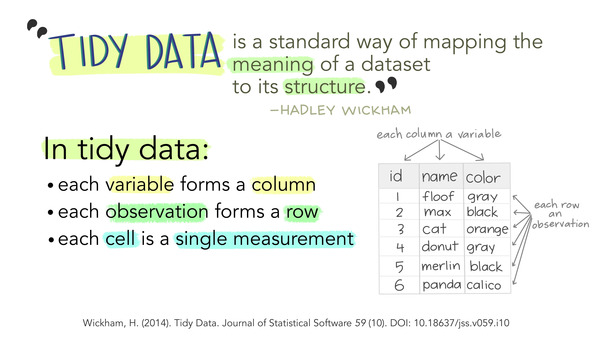
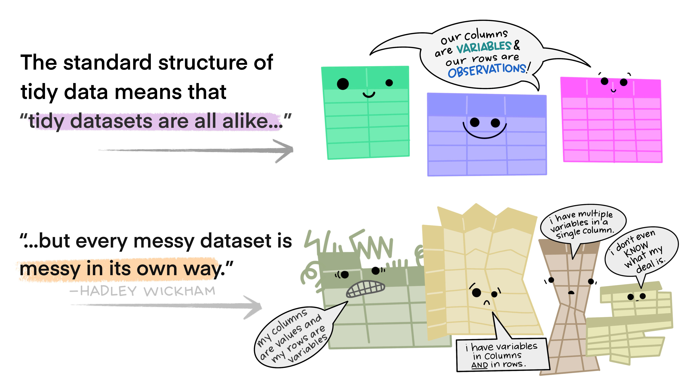
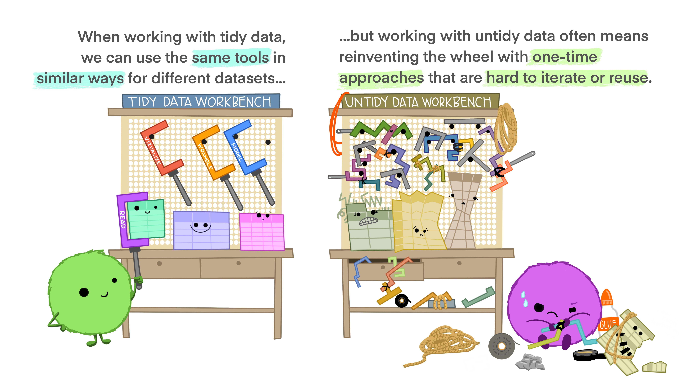
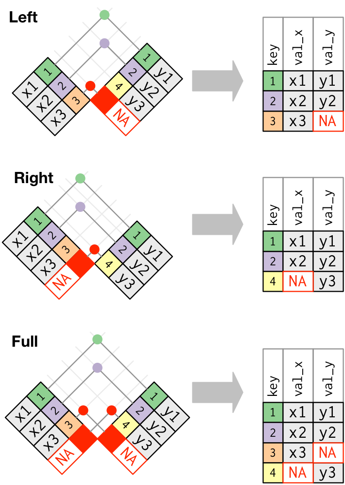
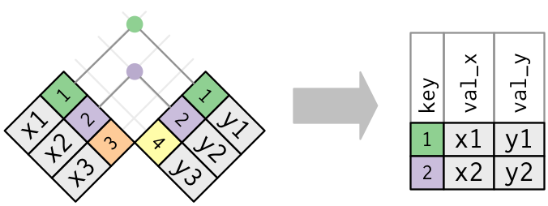

# Data Wrangling: `tidyr` {background-color="#92A86A"}

-   pivots (`tidyr`)
-   joins (`dplyr`)

## Reminder: Tidy Data

. . .

. . .

## Pivoting

Storing the same data in a different format

. . .

### long vs. wide

-   **wide** data contains values that do not repeat in the first column. (analysis; storage)
-   **long** format contains values that do repeat in the first column. (plotting)

## pivots

-   `pivot_longer` \| take wide data and make it long
-   `pivot_wider` \| take long data and make it wide

## Joins

Combining data across different datasets, using common information (often: IDs)

. . .

**Mutating Joins**

add new variables to a data frame from matching observations in another

. . .

-   **`left_join`**: keeps all rows in first df; adds all matching information from second df; adds NAs for any observations missing information
-   **`right_join`**: keeps all observations in second df
-   **`full_join`**: keeps all observations in either df

. . .

. . .

**`inner_join`**: takes only rows in *both* dfs

## Binding dataframes

-   `bind_rows()` - stack different dataframes on top of one another, combining information where column names are the same \<- *what I used to combine the three datasets after wrangling*
-   `bind_cols()` - stack dataframes next to one another; will assume rows match up \<- use with caution
